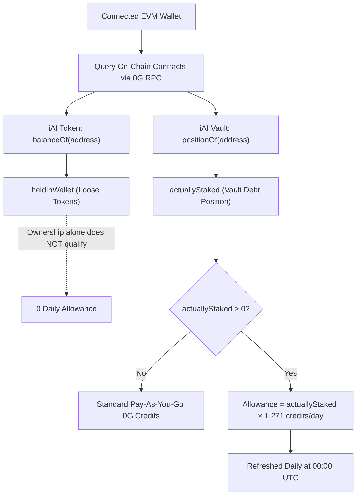
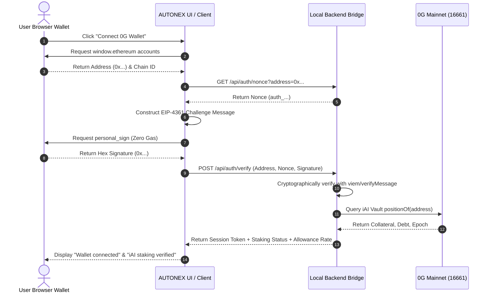
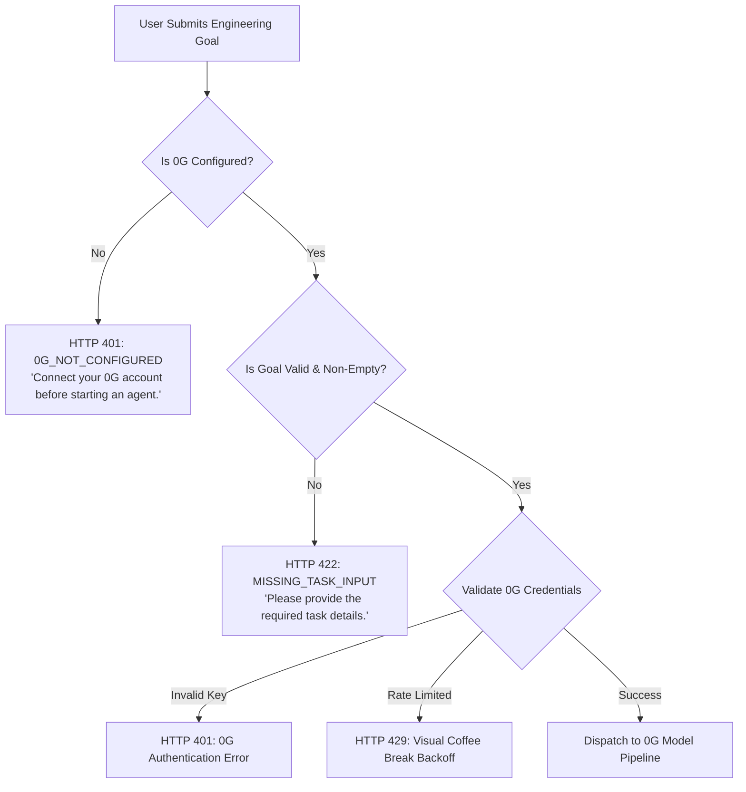

# AUTONEX: 0G Private Computer & iAI Compute Architecture

> **Decentralized Multi-Agent Autonomous Engineering Workspace**  
> Powered by **0G Private Computer** (Confidential Decentralized Inference), **Arkiv Rabdi DB-Chain** (Verifiable Metadata & Consensus Proofs), and **Ethereum Swarm** (Content-Addressed Context & Artifact Storage).

---

## 1. Executive Summary & Separation of Concerns

AUTONEX orchestrates autonomous software engineering teams across a real-time 3D spatial floor. Centralized AI APIs present critical vulnerabilities: single points of failure, vendor lock-in, data harvesting, and opaque billing. AUTONEX resolves these concerns by anchoring its compute and inference infrastructure directly into **0G Private Computer (0G Compute)** alongside an on-chain **iAI token staking economy**.

### Tri-Pillar Decentralized Infrastructure

```
 ┌────────────────────────────────────────────────────────────────────────┐
 │                      AUTONEX ENGINEERING WORKSPACE                     │
 └───────┬──────────────────────────────┬──────────────────────────┬──────┘
         │                              │                          │
         ▼                              ▼                          ▼
 ┌──────────────────────┐    ┌──────────────────────┐    ┌──────────────────────┐
 │  0G PRIVATE COMPUTER │    │   ARKIV RABDI CHAIN  │    │    ETHEREUM SWARM    │
 │ (Decentralized LLMs) │    │ (State & Proofs DB)  │    │ (Decentralized BZZ)  │
 ├──────────────────────┤    ├──────────────────────┤    ├──────────────────────┤
 │ • 125+ Open Models   │    │ • Project Schemas    │    │ • Full Code Bundles  │
 │ • TEE Privacy Modes  │    │ • Quorum Proofs      │    │ • Markdown Reports   │
 │ • Real x_0g_trace    │    │ • BZZ Pointers       │    │ • 64-hex Content ID  │
 │ • iAI Staking Engine │    │ • Zero-Gas Reads     │    │ • Bit-level SHA-256  │
 └──────────────────────┘    └──────────────────────┘    └──────────────────────┘
```

| Layer | Technology | Primary Role | Data Stored / Handled | Economic Model |
| :--- | :--- | :--- | :--- | :--- |
| **Inference & Execution** | **0G Private Computer** | Confidential agent reasoning, DAG planning, code generation, and critique | Prompts, tool calls, reasoning traces, Borda ballots | 0G Compute Credits / iAI Daily Staking Allowance |
| **Metadata & Ledger** | **Arkiv DB-Chain** (Rabdi Testnet, ID: 7794095) | Verifiable state, project schemas, quorum consensus records, SHA-256 hashes | Entity records (`autonex.user`, `autonex.project`, `autonex.context_ref`) | Low-cost `tGLM` gas, zero-gas public RPC reads |
| **Heavy Payload Storage** | **Ethereum Swarm** (BZZ) | Decentralized, immutable content-addressed storage | Large context files, synthetic reports, multi-file codebases | Swarm Postage Batches (BZZ) |

---

## 2. 0G Network & Smart Contract Topology

AUTONEX interfaces directly with the official **0G Mainnet (Aristotle)** for on-chain identity, cryptographic wallet verification, and staking inspection.

### A. Network Parameters
- **Network Name:** 0G Mainnet (Aristotle)
- **Chain ID:** `16661` (`0x4115` in hexadecimal)
- **Public EVM RPC:** `https://evmrpc.0g.ai`
- **Block Explorers:** [https://chainscan.0g.ai](https://chainscan.0g.ai) | [https://comfyscan.io](https://comfyscan.io)
- **Native Currency:** `0G` (18 decimals)

### B. Verified Smart Contracts
| Contract Designation | Contract Address | Verified Functions & ABI Signatures |
| :--- | :--- | :--- |
| **iAI Token (ERC-20)** | `0xc77FBd3824cc68e612b26114D176879aDdc29463` | `balanceOf(address account) view returns (uint256)`<br>`symbol() view returns (string)`<br>`decimals() view returns (uint8)` |
| **iAI Collateral & Staking Vault** | `0x94a5d41dfae4f2ee7c61a80f33a5085c8c252c70` | `positionOf(address account) view returns (uint256 collateral, uint256 debt, uint256 epoch)` |

---

## 3. iAI Staking Economics & Daily Allowance Engine

The AUTONEX 0G integration provides preferential compute allocation to users participating in the iAI ecosystem on 0G Mainnet.



### A. Strict Distinction Between Holding and Staking
AUTONEX enforces a strict on-chain distinction between holding raw ERC-20 tokens and locking collateral into the protocol:
1. **Wallet Balance (`heldInWallet`):** Sourced from `balanceOf(account)`. Loose tokens in a wallet do **not** grant daily compute allowances.
2. **Actual Staked Position (`actuallyStaked`):** Sourced from `positionOf(account)` on the Vault contract. The `debt` output represents the active staked iAI backed by locked `a0G` collateral.

### B. Mathematical Allowance Formula
When an active staking position is verified, AUTONEX calculates the user's daily credit allocation:

$$\text{Daily Compute Credits} = \text{Eligible Staked iAI} \times 1.271$$

- **Multiplier Rate:** Exactly `1.271` compute credits per staked iAI per day.
- **Refresh Schedule:** Daily synchronization at `00:00 UTC`.
- **Consumption Priority:** Daily staked allowances are consumed prior to drawing down raw user credit pools.

---

## 4. Cryptographic Authentication & Zero-Gas Verification

To guarantee that users control the 0G address claiming staking positions without requiring gas fees or exposing private keys, AUTONEX implements an **EIP-4361 / EIP-191 Nonce Challenge Protocol**.



### Challenge Message Format
```text
AUTONEX AI Virtual Office Authentication
Sign in to verify 0G Private Computer & iAI Holder Staking eligibility.

Wallet: 0x9bca40277f9850c8227b6c7c427eb5c8b209d738
Nonce: auth_7f8a9b2c3d4e5f6a
Issued At: 2026-11-06T12:00:00.000Z
Chain ID: 16661 (0G Mainnet)

Notice: This action will not cost gas or perform an on-chain transaction.
```

---

## 5. 0G Private Computer Router & Model Orchestration

All multi-agent reasoning, planning, code writing, and critique tasks route through the centralized **0G Private Computer Router**.

### A. Endpoint Topology
- **Router Base URL:** `https://router-api.0g.ai/v1`
- **Inference Route:** `POST https://router-api.0g.ai/v1/chat/completions`
- **Model Catalog Route:** `GET https://router-api.0g.ai/v1/models`
- **Authentication Scheme:** `Authorization: Bearer <0g_api_key>`
- **Catalog Size:** 125+ verified decentralized models

### B. Hardware-Secured Trust Modes
AUTONEX supports 0G's native hardware trust modes through custom request headers:
- `standard` (`X-0G-Provider-Trust-Mode: standard`): High-throughput routing across all validated decentralized nodes.
- `verified` (`X-0G-Provider-Trust-Mode: verified`): Cryptographically verifies provider provenance and response attestation.
- `private` (`X-0G-Provider-Trust-Mode: private`): Enforces hardware-level **Trusted Execution Environments (TEE)**, ensuring prompt context and model weights remain confidential from node operators.

### C. Task-Based Model Routing Matrix
AUTONEX maps specific engineering workflows and agent personas to optimal 0G models:

| Task Domain | Primary 0G Model | Secondary / Fallback | Assigned Autonomous Agent | Context Window |
| :--- | :--- | :--- | :--- | :--- |
| **Planning & Framing** | `glm-5.3-flash` | `kimi-k3`, `deepseek-v4.1-flash` | **M0 (Diya - Lead Engineering Manager)** | 1,180,000 tokens |
| **Code Synthesis** | `qwen3-coder-flash` | `deepseek-v4.1-flash`, `deepseek-v4-flash` | **W_backend_0 (Rohan - Backend Engineer)** | 1,000,000 tokens |
| **QA & Verification** | `kimi-k2.7-code` | `deepseek-v4.1-flash`, `qwen3-coder-flash` | **W_qa_0 (Nisha - QA & Test Engineer)** | 262,144 tokens |
| **Swarm Divergence** | `qwen3.7-flash` | `qwen-flash`, `qwen3.5-flash` | **Swarm Agents (S0 to S49)** | 128,000 tokens |
| **Consensus Voting** | `qwen-flash` | `qwen3.7-flash` | **Borda Count Quorum Tallying Engine** | 128,000 tokens |
| **Final Synthesis** | `qwen3-coder-flash` | `deepseek-v4.1-flash`, `glm-5.3-flash` | **Synthesis & Deliverable Compiler** | 1,000,000 tokens |

---

## 6. Telemetry, Billing & Real Trace Capture (`x_0g_trace`)

Unlike systems that rely on simulated tokens or fake balance counters, AUTONEX extracts and logs live cryptographic billing telemetry returned directly in 0G response payloads.

### Live 0G Telemetry Payload
```json
{
  "id": "as-18nkxifpad",
  "model": "glm-5.3-flash",
  "choices": [
    {
      "index": 0,
      "message": {
        "role": "assistant",
        "content": "Decomposed 3-stage DAG architecture..."
      },
      "finish_reason": "stop"
    }
  ],
  "usage": {
    "prompt_tokens": 150,
    "completion_tokens": 45,
    "total_tokens": 195
  },
  "x_0g_trace": {
    "billing": {
      "currency": "usd",
      "input_cost": "2",
      "output_cost": "3",
      "total_cost": "5",
      "total_cost_usd_micro": "5"
    },
    "provider": "0x000000003f486c7198d6203568a98d02b91f8044",
    "provider_identity": "baidu",
    "request_id": "69fbd20c-368e-4d4f-b0f9-4da855bdaef7"
  }
}
```

### Trace Metrics Captured in Real-Time
1. **`billing.total_cost_usd_micro`:** Micro-USD charge for the specific request.
2. **`provider`:** On-chain address of the physical hardware node executing the inference.
3. **`provider_identity`:** Attestation identity of the provider.
4. **`request_id`:** Unique, non-reusable identifier recorded in monotonic execution logs.

---

## 7. Permission Scope & Balance Handling Compliance

### The `sk-` vs `mk-` Scope Architecture
A critical design requirement of 0G Private Computer:
- **Inference Keys (`sk-...`):** Strictly restricted to executing completions (`POST /v1/chat/completions`). Any call to `GET /v1/account` or `GET /v1/account/balance` with an `sk-` key intentionally returns:
  ```json
  HTTP 403 Forbidden
  {"error": {"code": "insufficient_scope", "message": "Insufficient permissions"}}
  ```
- **Management Keys (`mk-...`):** Intended solely for administrative dashboards ([pc.0g.ai](https://pc.0g.ai)).

### Compliant UI Implementation
In strict compliance with 0G engineering standards, AUTONEX:
- **Never fabricates simulated balances.**
- **Accurately displays the verified badge:** `Compute balance unavailable`.
- Accompanies the badge with informative tooltips explaining the 0G permission architecture.

---

## 8. Runtime Execution Guards & Resilience

AUTONEX embeds defensive boundaries to guarantee zero unauthorized execution and flawless error propagation:



1. **Strict 401 Propagation:** Invalid or revoked 0G keys halt the execution graph immediately without falling back to mock generators.
2. **Visual Rate-Limit Backoff (Pantry Mechanism):** On HTTP 429, affected agents physically walk to the office pantry in the 3D scene, waiting out the retry-after window while the AIMD token bucket handles rate limiting.
3. **65-Second Deep Reasoning Window:** Prevents premature timeouts on complex chain-of-thought models such as `deepseek-v4.1-flash` and `glm-5.3-flash`.

---

## 9. Frontend UI Implementation & 10 Explicit State Badges

The **0G Private Computer & iAI Hub Modal** ([`frontend/src/ui/ZGConfigModal.tsx`](file:///d:/AUTONEX/frontend/src/ui/ZGConfigModal.tsx)) and Toolbar implement the 10 formal states:

| Required State Badge | Visual State | Trigger Condition |
| :--- | :--- | :--- |
| `Wallet not connected` | Gray neutral badge | EVM provider not connected or accounts unselected |
| `Wallet connected` | Green badge + ChainScan link | User wallet connected and verified on Chain ID 16661 |
| `iAI staking not detected` | Amber warning badge | Vault query reports `positionOf(address).debt == 0` |
| `iAI staking verified` | Emerald success badge | Vault query confirms active debt position; shows $1.271 \times \text{staked}$ |
| `API key missing` | Slate neutral badge | `0G_API_KEY` empty or unconfigured |
| `API key invalid` | Crimson danger badge | 0G Router returns 401 `invalid_auth` |
| `API connection verified` | Cyan glow badge | Validated ping completion against live 0G Router |
| `Compute balance unavailable` | Muted indigo badge | Compliant status for inference-tier (`sk-`) API keys |
| `Inference successful` | Bright emerald badge | Live completion returned with verifiable `x-request-id` |
| `Inference failed` | Red error badge | Network timeout, 402 out-of-credits, or node exception |

---

## 10. Verification & Test Suite

The 0G integration is validated by comprehensive Vitest test suites:

| Test File | Focus & Scenarios Verified | Passing Tests |
| :--- | :--- | :--- |
| [`frontend/src/tests/iai-integration.test.ts`](file:///d:/AUTONEX/frontend/src/tests/iai-integration.test.ts) | EIP-4361 wallet nonce authentication, held vs. staked iAI distinction, $1.271$ credit allowance formula, balance scope compliance | 7 / 7 |
| [`frontend/src/tests/pipeline-0g.test.ts`](file:///d:/AUTONEX/frontend/src/tests/pipeline-0g.test.ts) | Centralized 0G routing, task-to-model matrix, strict 401 error propagation, rate-limiting backoff, 402 insufficient balance | 5 / 5 |
| [`frontend/src/tests/zg-connection.test.ts`](file:///d:/AUTONEX/frontend/src/tests/zg-connection.test.ts) | Live key validation, invalid key handling, network failure recovery | 3 / 3 |
| [`frontend/src/tests/zg-integration.test.ts`](file:///d:/AUTONEX/frontend/src/tests/zg-integration.test.ts) | TEE trust modes, catalog model availability, agent persona model assignments | 12 / 12 |
| [`frontend/src/tests/execution-guards.test.ts`](file:///d:/AUTONEX/frontend/src/tests/execution-guards.test.ts) | Hard runtime execution blocking when 0G is unconfigured or unauthenticated | 3 / 3 |

### Running the Diagnostic Verification
```bash
# Run all 0G and iAI test suites
cd frontend
npx vitest run src/tests/iai-integration.test.ts src/tests/pipeline-0g.test.ts src/tests/zg-connection.test.ts
```

