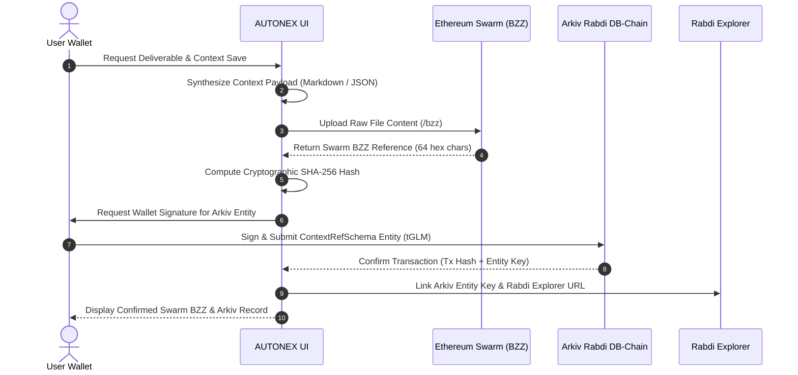
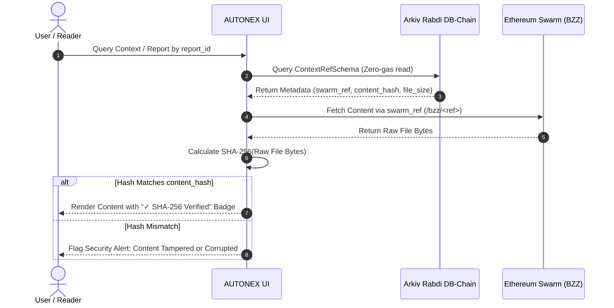

# AUTONEX: Decentralized Data-Storage Architecture (Arkiv + Ethereum Swarm)

> **Decentralized Multi-Agent Autonomous Engineering Workspace**  
> Powered by **0G Private Compute** (Inference), **Arkiv Rabdi DB-Chain** (Metadata & Source of Truth), and **Ethereum Swarm** (Content-Addressed Context & Artifact Storage).

---

## 1. Executive Summary & Separation of Concerns

AUTONEX integrates a decentralized, cost-optimized, and cryptographically verified storage layer by pairing **Arkiv** with **Ethereum Swarm**:

| Layer | Technology | Primary Role | Data Stored | Gas / Economic Model |
| :--- | :--- | :--- | :--- | :--- |
| **Inference & Execution** | **0G Private Computer** ([Architecture Spec](file:///d:/AUTONEX/docs/0G_ARCHITECTURE.md)) | Confidential model routing & agent deliberation | LLM prompts, tool execution, DAG steps | 0G Compute Credits |
| **Metadata & Identity** | **Arkiv DB-Chain** (Rabdi Testnet, ID: 7794095) | Verifiable source of truth, indexes, pointers, consensus | User identity, project metadata, report pointers, SHA-256 hashes, quorum proofs | Low-cost `tGLM` native token, zero-gas public reads |
| **Heavy File Payloads** | **Ethereum Swarm** (BZZ) | Immutable, content-addressed decentralized storage | Large context files, Markdown synthesis reports, full code bundles | Swarm Postage Batches / BZZ content addressing |

---

## 2. Architecture & Workflow Pipelines

### A. Context File Upload Pipeline



### B. Cryptographically Verified Retrieval Pipeline



---

## 3. Arkiv Entity Schemas

### 1. `autonex.user`
Represents registered users and their connected Web3 wallet.
- `user_id` (string, indexed): Unique application user ID.
- `wallet` (address, indexed): Checksummed EVM wallet address.
- `display_name` (string): User moniker.
- `created_at` (u64, indexed): Unix epoch seconds.

### 2. `autonex.project`
Represents an engineering workspace/project.
- `project_id` (string, indexed): Unique slug or UUID.
- `user_id` (string, indexed): Linking back to user.
- `owner` (address, indexed): Wallet of creator.
- `name` (string, indexed): Project title.
- `status` (string, indexed): `ACTIVE`, `ARCHIVED`.
- `created_at` (u64, indexed): Creation timestamp.
- `description` (string, optional): High-level overview.

### 3. `autonex.context_ref`
The primary metadata pointer linking the application to Swarm storage.
- `report_id` (string, indexed): Unique deliverable report identifier.
- `project_id` (string, indexed): Associated project.
- `user_id` (string, indexed): Creator user.
- `owner` (address, indexed): Signer address.
- `storage_provider` (string, indexed): `swarm`.
- `swarm_ref` (string, indexed): 64-character Swarm BZZ content address.
- `content_hash` (string, indexed): Cryptographic `sha256:<hex>` hash.
- `file_name` (string): e.g. `report.md` or `context-manifest.json`.
- `content_type` (string): `text/markdown`, `application/json`.
- `file_size` (u64): Byte count.
- `created_at` (u64, indexed): Timestamp.
- `summary` (string, optional): One-line summary.

### 4. `autonex.run`, `autonex.swarm_round`, `autonex.deliverable`, `autonex.audit_log`
Preserved from Phase 3 & 4 for execution proofs, Borda quorums, code synthesis, and human-in-the-loop security logs.

---

## 4. Demonstrations of the 6 Arkiv Query Use Cases

All 6 queries are implemented in `frontend/src/services/arkiv/operations.ts` and `frontend/src/services/storageWorkflow.ts`:

### Query 1: User Lookup by Wallet Address
```typescript
import { getAddress } from 'viem';
import { and, eq } from '@arkiv-network/sdk/query';

export async function getArkivUserByWallet(walletAddress: string) {
  const checked = getAddress(walletAddress);
  const filter = and(
    eq('arkiv.schema', 'autonex.user'),
    eq('wallet', checked)
  );
  return arkivPublicClient.query(filter, { limit: 1 });
}
```

### Query 2: Projects Lookup by User ID
```typescript
export async function getArkivProjectsByUser(userId: string) {
  const filter = and(
    eq('arkiv.schema', 'autonex.project'),
    eq('user_id', userId)
  );
  return arkivPublicClient.query(filter, { limit: 50 });
}
```

### Query 3: Context References by Project ID
```typescript
export async function getArkivContextRefsByProject(projectId: string, limit = 25) {
  const filter = and(
    eq('arkiv.schema', 'autonex.context_ref'),
    eq('project_id', projectId)
  );
  return arkivPublicClient.query(filter, { limit });
}
```

### Query 4: Latest Context Reference for a Project
```typescript
export async function getLatestArkivContextRef(projectId: string) {
  const refs = await getArkivContextRefsByProject(projectId, 10);
  if (!refs || refs.length === 0) return null;
  refs.sort((a, b) => b.createdAt - a.createdAt);
  return refs[0];
}
```

### Query 5: Single Context Reference by Report ID
```typescript
export async function getArkivContextRefByReportId(reportId: string) {
  const filter = and(
    eq('arkiv.schema', 'autonex.context_ref'),
    eq('report_id', reportId)
  );
  const res = await arkivPublicClient.query(filter, { limit: 1 });
  return res.entities?.[0] ?? null;
}
```

### Query 6: Public Network Context References
```typescript
export async function getAllArkivContextRefs(limit = 30) {
  const filter = eq('arkiv.schema', 'autonex.context_ref');
  return arkivPublicClient.query(filter, { limit });
}
```

---

## 5. Security & Cryptographic Integrity Guarantees

1. **Content Addressing & Bit-for-bit Verification**:
   Before rendering any file retrieved from Swarm, AUTONEX computes its SHA-256 digest using the native Web Crypto API (`crypto.subtle.digest('SHA-256', bytes)`). If the digest fails to match the `content_hash` recorded on Arkiv, the UI alerts the user and prevents code execution.
2. **Zero Private Key Exposure**:
   All state changes (`registerArkivUser`, `createArkivProject`, `saveArkivContextRef`) require user wallet signatures through Viem/Wagmi. No server-side keys or secrets are required in frontend code.
3. **90-Day Economic Lifecycle & Extension**:
   Records default to a 90-day storage term on Rabdi DB-Chain. Users can extend preservation anytime using `extendArkivEntity(walletClient, entityKey, days)` or delete with `deleteArkivEntity(walletClient, entityKey)` to maintain low cost.

---

## 6. How to Run & Verify

1. **Unit & Integration Tests**:
   ```bash
   npm run check
   ```
   Runs `tsc --noEmit` and executes all 16 Vitest test suites (112 tests passing).

2. **Standalone Reproducer Script**:
   ```bash
   node scripts/reproduce-swarm-arkiv.mjs
   ```
   Exercises Rabdi DB-Chain JSON-RPC queries, Swarm BZZ content derivation, and SHA-256 cryptographic verification.

