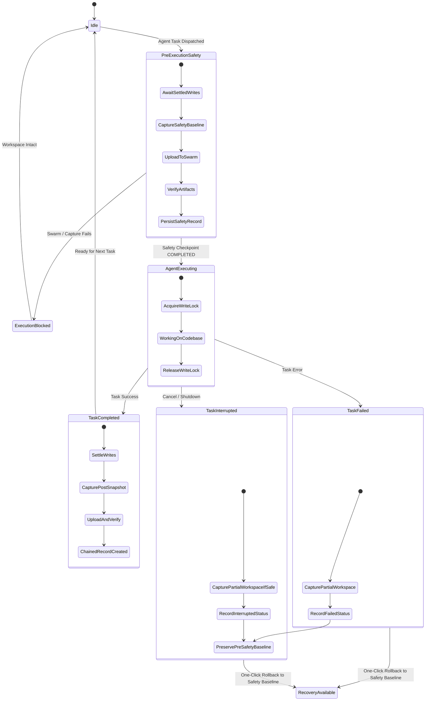

# AUTONEX CHECKPOINT ENGINE — AUTOMATIC AGENT EXECUTION CHECKPOINTING (PHASE 7)

## Overview
The Automatic Agent Execution Checkpointing layer integrates `AUTONEX_CHECKPOINT_ENGINE` directly into the agent task lifecycle. It guarantees that complete binary codebase archives and versioned AI context snapshots are captured and anchored to decentralized Ethereum Swarm storage before and after task operations, without modifying existing agent pipelines or consuming 0G / iAI compute credits.

---

## Agent Lifecycle State Machine & Triggers



---

## 4 Core Lifecycle Triggers

### 1. Before Execution (Pre-Execution Safety Gate)
- **Trigger**: Called immediately before an agent starts modifying the project workspace (`coordinator.onBeforeTaskExecution(ctx)`).
- **Actions**:
  1. Checks idempotency registry (`pre:${projectId}:${taskId}`).
  2. Acquires workspace snapshot mutex to ensure no conflicting operations.
  3. Captures workspace TAR + Zstandard archive and unencrypted AI context.
  4. Encrypts both with AES-256-GCM and uploads to real Ethereum Swarm content-addressed storage.
  5. Verifies both references via bit-for-bit SHA-256 integrity retrieval.
  6. Persists pre-execution checkpoint in SQLite with `executionStatus: 'In Progress'` and `lifecycleStatus: 'COMPLETED'`.
  7. Registers the checkpoint as the active task safety baseline (`activeTaskSafetyBaselines.set(taskId, checkpointId)`).
- **Fail-Safe Gate**: If Swarm storage is unreachable or pre-execution capture fails, throws `PreExecutionSafetyCheckpointFailedError` and **aborts execution immediately**. The workspace remains completely untouched.

### 2. Successful Completion (Post-Execution Checkpoint)
- **Trigger**: Called when an agent successfully completes a task (`coordinator.onTaskCompleted(ctx)`).
- **Actions**:
  1. Awaits all active file write locks (`writeTracker.awaitSettled(workspaceDir)`).
  2. Captures the resulting workspace archive and updated agent context.
  3. Uploads both to Swarm and verifies download integrity.
  4. Links parent checkpoint to the pre-execution safety baseline.
  5. Records checkpoint with `executionStatus: 'Completed'` and `lifecycleStatus: 'COMPLETED'`.
  6. Updates project lineage pointer for subsequent tasks.

### 3. Failed Execution (Partial State Capture & Recovery Preservation)
- **Trigger**: Called if an agent task encounters an unhandled exception, syntax error, or validator failure (`coordinator.onTaskFailed(ctx)`).
- **Actions**:
  1. Awaits write lock settling.
  2. Captures the actual partially modified workspace on disk.
  3. Captures failure details (error message, failed agent ID, task ID).
  4. Persists checkpoint with `executionStatus: 'Failed'` and `lifecycleStatus: 'FAILED'`.
  5. **Crucially preserves the pre-execution safety checkpoint** as `safetyCheckpointId` for instant, non-destructive recovery.
  6. Never labels an unsuccessful task as successful.

### 4. Interrupted Execution (User Cancellation & Startup Recovery)
- **Trigger**: Called when the user clicks cancel, system is halted (`haltEntireSystem`), or process terminates (`coordinator.onTaskInterrupted(ctx)`).
- **Actions**:
  1. Records partial workspace state when safely accessible.
  2. Marks checkpoint `executionStatus: 'Interrupted'`, `lifecycleStatus: 'INTERRUPTED'`.
  3. Keeps safety checkpoint active for rollback.
- **Startup Recovery**: On engine boot (`coordinator.recoverIncompleteCheckpoints(projectId)`), checks SQLite for any checkpoints left in `PENDING` or `UPLOADING` state from sudden power loss or process kill, marking them `INTERRUPTED` with audit reason.

---

## Concurrency, Idempotency & Write Settling

| Mechanism | Implementation | Guarantee |
| :--- | :--- | :--- |
| **Idempotency Registry** | `idempotencyRegistry: Map<string, CheckpointRecord>` | Repeated lifecycle events return existing checkpoint without duplicate Swarm uploads or database duplicates. |
| **Workspace Mutex** | `withWorkspaceSnapshotLock(workspaceDir, action)` | Serializes snapshot creation per workspace directory; eliminates race conditions across concurrent tasks. |
| **Write Lock Tracker** | `WorkspaceWriteTracker` (`acquire` / `release` / `awaitSettled`) | Prevents TAR capture while agent file descriptors are actively flushing to disk. |
| **Project Isolation** | Scoped strictly by `projectId` | Tasks executing in project A never block or interfere with project B. |

---

## Credit Independence Verification
- **Zero 0G / iAI Token Consumption**: The checkpoint engine does not call LLMs or external inference APIs to compute SHA-256 hashes, generate TAR archives, or build file manifests.
- **Storage Independence**: Operates directly via native Bee SDK and SQLite metadata tables. Checkpoint creation, diffing, and restoration work normally even if compute credits are zero.

---

## Test Verification Summary

13 automated integration tests executed under Vitest (`src/tests/checkpoint-agent-integration.test.ts`):

```bash
 ✓ src/tests/checkpoint-agent-integration.test.ts (13) 419ms
   ✓ AUTONEX Checkpoint Engine: Automatic Agent Execution Checkpointing (Phase 7) (13)
     ✓ 1. Successful task: captures pre-execution baseline, settles writes, and produces verified post-execution checkpoint
     ✓ 2. Failed task: captures partial state, marks execution FAILED, and preserves pre-execution safety checkpoint for recovery
     ✓ 3. Interrupted task: captures partial state, marks execution Interrupted, and preserves safety baseline
     ✓ 4. User cancellation: clean handling preserving pre-execution checkpoint for immediate restore
     ✓ 5. Empty task: creates valid archive and context for workspace with 0 files
     ✓ 6. Task with no file modifications: pre and post checksums and manifests match exactly
     ✓ 7. Multiple consecutive tasks: preserves lineage chaining across T1 -> T2 -> T3
     ✓ 8. Concurrent tasks: mutex serialization guarantees consistent TAR archives without race condition
     ✓ 9. Storage failure before execution: throws PreExecutionSafetyCheckpointFailedError and BLOCKS project modifications
     ✓ 10. Storage failure after execution: preserves pre-execution safety checkpoint in database
     ✓ 11. Backend restart during checkpoint creation: startup recovery resolves orphaned in-flight checkpoints
     ✓ 12. Manual checkpoint: user can trigger an ad-hoc checkpoint at any time
     ✓ 13. Idempotency: repeated identical lifecycle triggers return the existing checkpoint without duplicate uploads
```

