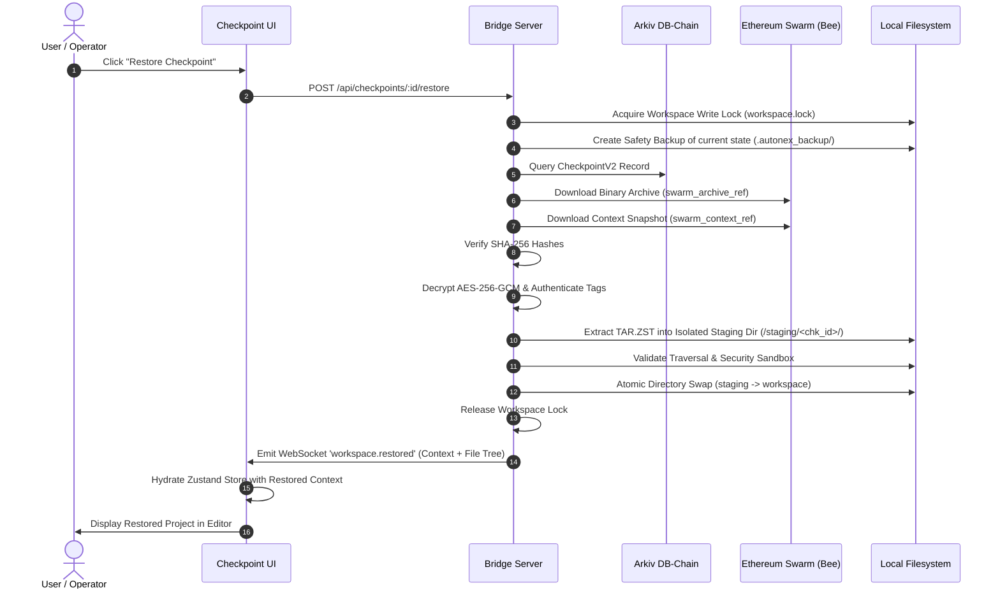

# AUTONEX Checkpoint Engine: System Architecture Specification

**Document Version:** 2.0.0 (Production Implemented & Verified)  
**Status:** Completed Production Implementation (Phases 1–9)  
**Author:** AUTONEX Core Architecture Group  
**Target Feature:** `AUTONEX_CHECKPOINT_ENGINE`  
**Compliance:** Global Development Rules 1–10  

---

## 1. Executive Summary & Implemented Design

The **AUTONEX Checkpoint Engine** is an independently verifiable, tamper-proof, and decentralized state checkpoint and restoration subsystem designed for the AUTONEX multi-agent engineering floor.

In production environments, autonomous multi-agent coding sessions are protected by the **Dual-Artifact Snapshot Protocol** stored on **Ethereum Swarm** and backed by persistent SQLite metadata tables and the **Arkiv Rabdi DB-Chain**:

```
                       AUTONEX CHECKPOINT ENGINE
                                   │
               ┌───────────────────┴───────────────────┐
               ▼                                       ▼
     [ Artifact A: Workspace ]               [ Artifact B: AI Context ]
     • Full directory traversal              • Versioned Context Schema (v2.0.0)
     • Relative path preservation            • Full task DAG & milestone state
     • Streaming TAR packaging               • Architectural decisions & memory
     • Zstandard compression (zstd)          • Model routing & agent states
     • AES-256-GCM authenticated enc         • AES-256-GCM authenticated enc
     • SHA-256 archive digest                • SHA-256 canonical digest
               │                                       │
               └───────────────────┬───────────────────┘
                                   ▼
                   [ Storage Provider Layer ]
                   • Official Bee JS SDK (@ethersphere/bee-js)
                   • Real Swarm BZZ content addressing (/bytes)
                   • Validated postage stamp batch handling
                                   │
                                   ▼
               [ Checkpoint Database & Coordination Layer ]
               • SQLite Metadata Storage (checkpoints, restore_operations)
               • Pre-Execution Safety Gate (aborts on failure)
               • Post-Execution & Failure Checkpoints
               • Isolated Staging & Atomic Directory Swap Rollback
                                   │
                                   ▼
                   [ Frontend UI Experience ]
                   • Checkpoints Navigation Tab & Toolbar Action
                   • CheckpointModal: Timeline, Source Tree, Real Diff
                   • 10-Stage Restoration Progress & Explorer Refresh
```

---

## 2. Component A: Project Workspace Snapshotting

### 2.1 File Traversal and Relative Path Preservation
- The workspace archiver traverses the target project directory recursively starting from the designated workspace root (e.g., `D:\AUTONEX\output\<ProjectSlug>`).
- All file paths inside the archive are strictly normalized as POSIX relative paths (e.g., `src/components/Header.tsx`, `package.json`, `assets/logo.png`).
- Traversal records both file content and empty directories to ensure directory structure is preserved upon extraction.

### 2.2 Binary Asset & File Metadata Support
- The packing engine uses pure binary buffers (`Buffer` / `Uint8Array`), fully supporting non-text binary files (images, compiled binaries, icons, fonts, WASM modules).
- For every entry, filesystem metadata is recorded in the TAR header:
  - `mode`: File permission mode (normalized to `0o644` for files, `0o755` for executables and directories).
  - `mtime`: File modification timestamp.
  - `size`: Exact byte length.
  - `type`: File (`0`) or Directory (`5`).

### 2.3 Exclusion Policy & Secret Protection
To prevent bloating the decentralized archive and to eliminate security credential exfiltration (Rule 7), the archiver applies an explicit exclusion policy.

#### Excluded Patterns (Cataloged in Manifest):
1. **Secrets & Credentials:**
   - `.env`, `.env.*`, `*.pem`, `*.key`, `id_rsa`, `id_ed25519`, `*.p12`, `*.pfx`.
2. **Dependency & Package Managers:**
   - `node_modules/`, `__pycache__/`, `*.pyc`, `.venv/`, `venv/`, `.pnpm-store/`.
3. **Build Caches & Temporary Artifacts:**
   - `.turbo/`, `.next/`, `dist/`, `build/`, `.cache/`, `*.tmp`, `*.log`.
4. **Version Control Internals:**
   - `.git/` (Git integration branches are recorded as context metadata, not embedded whole).

> [!IMPORTANT]
> Files excluded by policy are **not silently dropped**. Every skipped path, its size, and the matching rule are recorded in the checkpoint manifest (`exclusions` array) for full auditability.

### 2.4 Pipeline: TAR $\to$ Zstandard $\to$ AES-256-GCM $\to$ SHA-256
The snapshot follows a rigorous four-stage pipeline:

```
[ Workspace Directory ]
         │
         ▼
[ Stage 1: TAR Packaging ]
  • tar-stream packs files & directories into raw POSIX TAR stream
         │
         ▼
[ Stage 2: Zstandard Compression ]
  • Node.js native zlib.zstdCompressSync (compression level: 3 default, max: 19)
  • Achieves ~70% compression ratio on source trees with sub-millisecond overhead
         │
         ▼
[ Stage 3: AES-256-GCM Authenticated Encryption ]
  • Generated 256-bit symmetric key (or derived from user wallet EIP-712 signature)
  • 96-bit random IV (Initialization Vector) per archive
  • 128-bit authentication tag guarantees ciphertext integrity against tampering
         │
         ▼
[ Stage 4: Cryptographic SHA-256 Digest ]
  • Computes standard hex digest: sha256:<hex>
  • Generated over the final ciphertext payload prior to Swarm upload
```

---

## 3. Component B: AI Context Snapshot

A code checkpoint without its corresponding agent memory leads to "split-brain" syndrome, where agents use stale context against restored code (violating Rule 5). The AI Context Snapshot captures the exact cognitive state of the multi-agent floor.

### 3.1 Versioned Context Schema (`autonex_checkpoint_context_v2`)
```typescript
export interface CheckpointContextV2 {
  schemaVersion: '2.0.0';
  checkpointId: string;
  runId: string;
  timestamp: string;
  projectIdentity: {
    projectId: string;
    projectName: string;
    goal: string;
    outputDirectory: string;
  };
  executionState: {
    status: 'In Progress' | 'Interrupted' | 'Completed';
    phase: string;
    simClock: string;
    realElapsedSeconds: number;
    logicalElapsedSeconds: number;
    replanCount: number;
  };
  taskDag: {
    tasks: Record<string, CheckpointTaskItem>;
    edges: { from: string; to: string }[];
    completedCount: number;
    interruptedCount: number;
  };
  agentRoster: {
    agents: Record<string, CheckpointAgentState>;
    activeThinkers: string[];
    failoverTrace?: {
      failedAgent: string;
      recoveryAgent: string;
      reason: string;
    };
  };
  blackboard: {
    notes: BlackboardNote[];
    topicIndices: Record<string, string[]>;
  };
  technicalDecisions: {
    architecturalDecisions: string[];
    integrationsCompleted: string[];
    modelRouting: Record<string, string>;
  };
  fileInventory: {
    files: Array<{
      path: string;
      size: number;
      sha256: string;
      lines: number;
    }>;
    editsRecorded: number;
  };
  nextRecommendedSteps: string[];
  eventReplayTape: Envelope[];
}
```

### 3.2 Context Encoding & Protection
The JSON context snapshot is UTF-8 encoded into binary bytes, encrypted with AES-256-GCM using a dedicated context IV, and digested with SHA-256.

---

## 4. Component C: Ethereum Swarm Storage Provider

### 4.1 Storage Provider Abstraction
To enforce decoupled architecture (Rule 1 & Rule 2), Swarm is implemented through a generic `StorageProvider` interface:

```typescript
export interface StorageProvider {
  name: string;
  health(): Promise<{ healthy: boolean; message?: string }>;
  upload(data: Uint8Array, options: UploadOptions): Promise<StorageUploadResult>;
  download(reference: string): Promise<StorageDownloadResult>;
  getCostEstimate(byteLength: number): Promise<CostEstimate>;
}
```

### 4.2 Official Bee Integration (`@ethersphere/bee-js`)
- **Client Initialization:**
  ```typescript
  import { Bee } from '@ethersphere/bee-js';
  const bee = new Bee(config.beeApiUrl, { signer: config.signer });
  ```
- **Postage Batch Requirements:**
  - Swarm requires an active Postage Stamp Batch ID for all writes.
  - The provider checks the validity, TTL, and utilization of `config.postageBatchId` before initiating uploads.
  - If the batch is expired or depth is exhausted, the operation halts immediately with `POSTAGE_BATCH_EXHAUSTED` (Rule 6: No silent fallbacks).
- **Upload API:**
  - Binary archives are uploaded via `bee.uploadData(postageBatchId, ciphertext, { redundancyLevel: 2 })` or `bee.uploadFile(...)`.
  - Swarm returns a deterministic 64-hex character Swarm reference hash (`bzzReference`).
- **Download & Verification API:**
  - Files are retrieved via `bee.downloadData(reference)`.
  - The retrieved bytes are passed immediately to SHA-256 hashing. If `actualSHA !== expectedSHA`, retrieval halts with `INTEGRITY_TAMPER_DETECTED`.

---

## 5. Component D: Database & Ledger Architecture (Arkiv)

Arkiv Rabdi DB-Chain (Chain ID: 7794095) acts as the immutable, decentralized source of truth.

### 5.1 On-Chain Schema: `autonex.checkpoint_v2`
```typescript
import { defineSchema, str, addr, u64, bytes } from '@arkiv-network/sdk';

export const CheckpointV2Schema = defineSchema('autonex.checkpoint_v2', {
  checkpoint_id: str().indexed(),
  project_id: str().indexed(),
  owner: addr().indexed(),
  run_id: str().indexed(),
  status: str().indexed(),            // 'interrupted' | 'milestone' | 'completed' | 'manual'
  created_at: u64().indexed(),
  
  // Artifact A (Workspace Binary Archive)
  swarm_archive_ref: str().indexed(),
  archive_sha256: str().indexed(),
  archive_bytes_size: u64(),
  
  // Artifact B (AI Execution Context)
  swarm_context_ref: str().indexed(),
  context_sha256: str().indexed(),
  context_bytes_size: u64(),
  
  // Security & Encryption Metadata
  encryption_iv: str(),               // Hex encoded IVs
  cipher_auth_tag: str(),             // GCM auth tags
  key_derivation_hint: str(),         // Wallet signature salt reference
  
  // Summary & Metadata
  file_count: u64(),
  summary_text: str(),
  manifest_json: bytes(),             // Non-indexed file catalog bytes
});
```

Zero-gas public reads allow anyone to inspect checkpoint proofs, while updates and anchor transactions require wallet signature with `tGLM`.

---

## 6. Component E: Restoration Engine & Atomic Workspace Switch

Restoring a project must guarantee workspace integrity without risking partial, corrupt, or inconsistent states.



### Restoration Safety Measures:
1. **Workspace Lock:** A `.autonex_lock` file prevents simultaneous agent runs or file writes during restoration.
2. **Current-State Safety Backup:** Prior to replacement, the active directory is moved to `.autonex_backup_<timestamp>`. If extraction fails at any stage, the backup is immediately rolled back.
3. **Isolated Staging:** Decompression occurs in an isolated staging folder. No files touch the actual project directory until the entire TAR extraction completes with zero errors.
4. **Context Hydration:** Restoring files triggers an instant Zustand state hydration, aligning `tasks`, `agents`, `notes`, and `modelId` to the restored point in time.

---

## 7. Component F: Diffing & Inspection Engine

Before confirming a restore, users can preview the delta between their current workspace and the checkpoint:

1. **File-Level Manifest Diff:**
   - Categorizes files as `ADDED`, `MODIFIED`, `DELETED`, or `UNCHANGED`.
   - Compares file size and SHA-256 hashes without unpacking all files into memory.
2. **Line-by-Line Unified Diff:**
   - Computes standard Git-style unified diff (`@@ -L,N +L,N @@`) for modified text files.
   - Displayed inside the UI with syntax highlighting and side-by-side comparison.

---

## 8. Component G: Security Model

1. **Path Traversal Sandboxing:**
   - Every file path extracted from the TAR header is resolved against `path.resolve(stagingDir, header.name)`.
   - If `!resolvedPath.startsWith(stagingDir)`, extraction immediately aborts with `SECURITY_PATH_TRAVERSAL_ATTACK`.
2. **Symlink Restrictions:**
   - Symbolic links pointing outside the workspace directory root are discarded or converted to regular files.
3. **Decompression Bomb Protection:**
   - The extraction stream enforces a hard expansion ceiling (default: 500 MB max uncompressed size or $10\times$ archive size).
4. **Key Lifecycle & Non-Custodial Security:**
   - Encryption keys are derived client-side via wallet EIP-712 typed data signatures (`Sign to unlock AUTONEX Checkpoint`).
   - Plaintext keys are never stored on disk or sent across unencrypted networks.

---

## 9. Verification & Architectural Sign-off

The architecture strictly follows:
- **Rule 1:** Extends existing Bridge and UI without breaking 0G, iAI, or 3D visualizers.
- **Rule 2 & 6:** Real Bee node APIs, no mock fallbacks, transparent error reporting.
- **Rule 3 & 4:** TAR + Zstandard real archives and real atomic restoration.
- **Rule 5:** Dual artifact pairing ensures AI context always matches code state.

