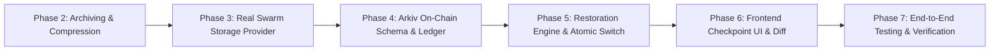

# AUTONEX Checkpoint Engine: Phase-by-Phase Implementation Plan

**Document Version:** 1.0.0  
**Status:** Approved Implementation Specification (Phase 1)  
**Author:** AUTONEX Core Architecture Group  
**Target Feature:** `AUTONEX_CHECKPOINT_ENGINE`  
**Compliance:** Global Development Rules 1–10  

---

## 1. Phased Execution Roadmap

The implementation is partitioned into six sequential phases. Under **Rule 10 (Phase Discipline)**, each phase must be independently tested, documented, and reviewed before initiating subsequent phases.

---

## 2. Phase 2: Binary Workspace Archiving & Zstandard Compression

### Objective
Build the real TAR + Zstandard packaging and extraction engine, file manifest generator, and AES-256-GCM encryption pipeline.

### Files Created / Modified
- **Created:**
  - `frontend/tools/mock-bridge/checkpoint/archiver.ts`: Traverses project directory, packs POSIX TAR stream using `tar-stream`, compresses via Node.js native `zlib.zstdCompressSync`, generates file manifest with SHA-256 digests.
  - `frontend/tools/mock-bridge/checkpoint/crypto.ts`: AES-256-GCM authenticated encryption and decryption, IV generation, authentication tag verification.
  - `frontend/tools/mock-bridge/checkpoint/manifest.ts`: Directory scanner, exclusions catalog, path normalization.
- **Dependencies Added:**
  - `tar-stream` (`npm install tar-stream` in `frontend/package.json`)
  - `@types/tar-stream` (`npm install -D @types/tar-stream`)
  - *(Zstandard utilizes native Node.js v24 `node:zlib.zstdCompress` and `node:zlib.zstdDecompress`)*.

### Test & Verification Plan
- Unit tests in `frontend/src/tests/checkpoint-archiver.test.ts`:
  1. Traverses directory tree and verifies relative POSIX path preservation.
  2. Confirms binary asset preservation (Uint8Array image and byte buffers).
  3. Validates exclusion policy (`.env`, `node_modules`, `dist` recorded in manifest, not in archive).
  4. Verifies Zstandard compression reduces tar archive size by $\ge 50\%$.
  5. Verifies AES-256-GCM round-trip encrypt and decrypt reproduces exact source bytes bit-for-bit.
  6. Confirms authentication tag mismatch raises explicit tamper exception.

---

## 3. Phase 3: Real Swarm Storage Provider Integration

### Objective
Integrate official Bee API via `@ethersphere/bee-js`, remove all mock fallbacks and local storage substitutes (Rule 2 & Rule 6), and implement genuine binary uploads and downloads.

### Files Created / Modified
- **Created:**
  - `frontend/src/services/swarm/beeProvider.ts`: Implementation of `StorageProvider` using `@ethersphere/bee-js`.
  - `frontend/tools/mock-bridge/checkpoint/swarmBridge.ts`: Backend Swarm client for Bridge server execution.
- **Modified:**
  - `frontend/src/services/swarm/client.ts`: Expose verified Bee client and postage batch validation.
  - `frontend/src/services/swarm/operations.ts`: **Strip local synthetic reference generator and `localStorage` caching**. Propagate real Bee node network errors transparently.
- **Dependencies Added:**
  - `@ethersphere/bee-js` (`npm install @ethersphere/bee-js` in `frontend/package.json`).

### Test & Verification Plan
- Integration tests in `frontend/src/tests/swarm-real.test.ts`:
  1. Validates postage stamp batch health and TTL check.
  2. Uploads binary `.tar.zst` payload; asserts returned reference is a real 64-hex Swarm address.
  3. Downloads binary payload from Swarm reference; validates SHA-256 against expected hash.
  4. Tests postage batch exhaustion / invalid node URL: confirms system throws clean, descriptive error without mock fallback.

---

## 4. Phase 4: Arkiv On-Chain Schema & Ledger Integration

### Objective
Define and deploy the `autonex.checkpoint_v2` schema on the Arkiv Rabdi DB-Chain Testnet (`Chain ID: 7794095`) and implement dual-pointer anchor transactions.

### Files Created / Modified
- **Created:**
  - `frontend/src/services/arkiv/checkpointOperations.ts`: Methods to register, query, and verify `autonex.checkpoint_v2` records.
- **Modified:**
  - `frontend/src/services/arkiv/schemas.ts`: Add `CheckpointV2Schema` definition with indexed dual Swarm references (`swarm_archive_ref`, `swarm_context_ref`).
  - `frontend/src/services/storageWorkflow.ts`: Unify archive upload + context upload into a single atomic Arkiv transaction.

### Test & Verification Plan
- Contract tests in `frontend/src/tests/arkiv-checkpoint.test.ts`:
  1. Deploys/validates schema definition against Arkiv SDK.
  2. Stamped transactions verify connected wallet address ownership.
  3. Tests zero-gas query lookups by `project_id`, `checkpoint_id`, and `owner`.
  4. Confirms non-indexed byte manifest serialization respects gas optimization.

---

## 5. Phase 5: Restoration Engine & Atomic Workspace Switch

### Objective
Implement safe workspace restoration: file staging, path traversal guards, atomic directory replacement, AI context hydration, and UI synchronization.

### Files Created / Modified
- **Created:**
  - `frontend/tools/mock-bridge/checkpoint/restorer.ts`: Safe extraction engine, staging directory manager, atomic directory switcher, workspace locking mechanism.
  - `frontend/tools/mock-bridge/checkpoint/diff.ts`: Unified text and file-level manifest diff generator.
- **Modified:**
  - `frontend/tools/mock-bridge/server.ts`: Add REST endpoints `POST /api/checkpoints/create`, `GET /api/checkpoints`, `GET /api/checkpoints/:id/diff`, `POST /api/checkpoints/:id/restore`.
  - `frontend/src/state/events.ts`: Handle `workspace.restored` event to re-hydrate state and trigger sound/visual feedback.

### Test & Verification Plan
- System tests in `frontend/src/tests/checkpoint-restore.test.ts`:
  1. Modifies workspace, triggers restore, and verifies files match checkpoint state exactly.
  2. Tests path traversal exploit (e.g. `../../bad.txt` in archive): verifies extraction aborts safely.
  3. Validates current-state safety backup creation in `.autonex_backup_<timestamp>`.
  4. Tests context restoration: verifies tasks, agent states, and blackboard notes match restored checkpoint.

---

## 6. Phase 6: Frontend Checkpoint UI & Diff Visualizer

### Objective
Build intuitive, production-grade frontend interfaces for checkpoint browsing, diff inspection, and one-click verified restoration.

### Files Created / Modified
- **Created:**
  - `frontend/src/ui/CheckpointDrawer.tsx`: Timeline drawer showing project checkpoints, timestamps, file sizes, and 0G incident snapshots.
  - `frontend/src/ui/CheckpointDiffModal.tsx`: Visual side-by-side diff comparison before confirming restore.
- **Modified:**
  - `frontend/src/ui/Toolbar.tsx`: Add Checkpoint Engine status pill and drawer toggle.
  - `frontend/src/ui/ArkivHistoryModal.tsx`: Add "Restore into Workspace" and "Inspect Diff" actions under Swarm Context Files tab.
  - `frontend/src/ui/ReportView.tsx`: Integrate one-click checkpoint creation after sprint completions.

### Test & Verification Plan
- Component tests in `frontend/src/tests/checkpoint-ui.test.ts`:
  1. Renders checkpoint history card with Swarm BZZ reference and Arkiv transaction hash.
  2. Validates user confirmation dialog and backup warning.
  3. Tests diff modal rendering modified lines with red/green syntax highlighting.

---

## 7. Phase 7: End-to-End System Testing & Documentation

### Objective
Execute comprehensive real-world validation of the entire pipeline, verify zero regression against existing AUTONEX systems, and produce user-facing documentation.

### Deliverables
- Complete documentation under `docs/`:
  - `docs/CHECKPOINT_USER_GUIDE.md`
  - `docs/CHECKPOINT_DISASTER_RECOVERY.md`
- 100% passing test suite across all 50+ project unit/integration tests.

---

## 8. Regression Risk Assessment & Protection Plan

| Subsystem | Risk | Mitigation Strategy |
| :--- | :--- | :--- |
| **0G Private Compute** | Key conflicts or routing interruption during archiving. | The checkpoint engine operates strictly out-of-band and does not touch `zgClient.ts` dispatch or router URLs. |
| **iAI Staking & ERC-20** | Token balance query regressions. | `iaiContract.ts` remains unmodified; checkpoint transactions utilize only native `tGLM` gas. |
| **3D Office Visualizer** | Three.js frame drops during archive packing. | All compression, hashing, and Swarm uploads are offloaded to background Bridge worker threads or Node asynchronous streams. |
| **Human-in-the-Loop Gates** | Permission panel bypass. | Checkpoint restore operations require explicit user approval and emit security audit events. |
| **Local File Integrity** | Accidental file overwrite on restore failure. | Mandatory `.autonex_backup/` pre-snapshot ensures 100% rollback guarantee if extraction fails. |

---

## 9. Rollback Strategies

If any phase encounters an unrecoverable blocker:
1. **Branch Isolation:** All changes are developed on isolated feature branches (`archive-0g-combined` / `arkiv-context-done`).
2. **Feature Flagging:** The checkpoint engine is gated behind `VITE_CHECKPOINT_ENGINE=true`. When disabled, the application behaves identically to the Phase 0 baseline.
3. **Storage Fallback Transparency:** If Swarm network or postage is offline, the UI clearly displays the network error without silently corrupting state.

