# AUTONEX Checkpoint Engine: Phase 0 Repository Audit

**Audit Date:** November 6, 2026  
**Target Feature:** `AUTONEX_CHECKPOINT_ENGINE`  
**Scope:** Complete repository architecture, workspace lifecycle, agent execution, context persistence, Swarm integration, and restoration mechanics.  
**Compliance:** Global Development Rules 1–10 (Preserve existing functionality, Real Swarm only, Real TAR+Zstandard binary archives, Real restoration, Exact context matching, No silent fallbacks, Security, Empirical testing, Documentation, Phase discipline).

---

## 1. Repository Architecture

AUTONEX is structured as a dual-engine autonomous coding platform consisting of three primary layers:

```
AUTONEX/
├── frontend/                     # React 18 + Vite + Three.js application & Node/TS Bridge
│   ├── src/
│   │   ├── api/                  # HTTP & WebSocket API client contracts (HttpClient, HttpStream)
│   │   ├── config/               # Rabdi chain config (7794095), 3D office layout, furniture
│   │   ├── services/             # Arkiv DB-Chain, Swarm, Checkpoint summary, Project bundles
│   │   │   ├── arkiv/            # Arkiv SDK schemas, public/wallet client, tGLM balance
│   │   │   ├── swarm/            # Ethereum Swarm gateway operations, SHA-256 calculation
│   │   │   ├── storageWorkflow.ts# Unified Swarm + Arkiv context upload & retrieval
│   │   │   └── checkpointSummary.ts# Structured AI execution snapshot generator & markdown formatter
│   │   ├── state/                # Zustand global store (`store.ts`), event reducer (`events.ts`), run engine (`engine.ts`)
│   │   ├── three/                # 3D spatial office canvas, agent rigs, pathfinding, visualizer
│   │   ├── swarm/                # 20-50 agent deliberative swarm canvas and idea board
│   │   └── ui/                   # React UI panels (Workspace, Inspector, ReportView, ErrorCheckpointModal, ArkivHistoryModal)
│   └── tools/
│       └── mock-bridge/          # Real Node.js Multi-Agent Bridge (`server.ts`, `realRunner.ts`, `zgClient.ts`)
├── bridge/                       # Python FastAPI Swarm & Gateway Server
│   ├── autonex_bridge/           # Swarm consensus controller, admission scheduler, capacity maps
│   └── pyproject.toml            # Python 3.11+ dependencies
├── backend/                      # Native PAG CLI (`opencode.exe`), Docker sandbox, context plugins
│   ├── bin/                      # CLI wrapper scripts (`autonex`, `pag`)
│   └── docker/                   # Isolated Docker compose, Squid egress proxy, SearXNG
└── docs/                         # System architecture whitepapers and specifications
```

### Verified Runtime Entry Points
- **Frontend App:** [frontend/src/main.tsx](file:///home/pritul-singh/AUTONEX/frontend/src/main.tsx) mounts the root React component [frontend/src/App.tsx](file:///home/pritul-singh/AUTONEX/frontend/src/App.tsx).
- **Execution Bridge Server:** [frontend/tools/mock-bridge/server.ts](file:///home/pritul-singh/AUTONEX/frontend/tools/mock-bridge/server.ts) hosts the HTTP REST API (port 8000) and WebSocket event stream (`/ws/events`).
- **Autonomous Multi-Agent Runner:** [frontend/tools/mock-bridge/realRunner.ts](file:///home/pritul-singh/AUTONEX/frontend/tools/mock-bridge/realRunner.ts#L165) executes real goal decomposition, DAG generation, file writes, and test validation gates using 0G Private Compute (`zgClient.ts`).
- **Python Swarm Bridge:** [bridge/autonex_bridge/main.py](file:///home/pritul-singh/AUTONEX/bridge/autonex_bridge/main.py) provides deliberative swarm consensus and token estimators.

---

## 2. Project Workspace Lifecycle

### Verified Location and Ownership
- **Physical Workspace Ownership:** The Bridge server ([frontend/tools/mock-bridge/realRunner.ts](file:///home/pritul-singh/AUTONEX/frontend/tools/mock-bridge/realRunner.ts#L312-L316)) creates and owns the physical project directory on disk.
- **Directory Path Formulation:**
  ```typescript
  const projectName = (plan.project_name || 'ProjectOutput').replace(/[^a-zA-Z0-9_-]/g, '');
  const outputDir = path.join('D:\\AUTONEX\\output', projectName);
  ```
  *(Note on POSIX/Linux: In Linux environments, `path.join('D:\\AUTONEX\\output', projectName)` evaluates relative to the process working directory, creating `./D:\AUTONEX\output/<projectName>`. This must be normalized in Phase 1).*
- **Creation Lifecycle:**
  1. Triggered in `executeRealRun(run)` after 0G Lead Engineering Manager (`Diya / M0`) decomposes the goal into tasks.
  2. Subdirectories and files are created as milestone tasks complete:
     - `fs.mkdirSync(path.dirname(targetFullPath), { recursive: true })` ([realRunner.ts:466](file:///home/pritul-singh/AUTONEX/frontend/tools/mock-bridge/realRunner.ts#L466))
     - `fs.writeFileSync(targetFullPath, cleanCode, 'utf-8')` ([realRunner.ts:467](file:///home/pritul-singh/AUTONEX/frontend/tools/mock-bridge/realRunner.ts#L467))
  3. `README.md` and report deliverables written at completion ([realRunner.ts:538-540](file:///home/pritul-singh/AUTONEX/frontend/tools/mock-bridge/realRunner.ts#L538-L540)).
- **Deletion/Cleanup Lifecycle:**
  - Currently, there is **no automatic deletion lifecycle**. Workspaces remain permanently in the output directory.
- **Frontend Workspace State:**
  - The frontend queries `GET /api/deliverables?dir=<outputDir>` ([frontend/tools/mock-bridge/server.ts#L386-L404](file:///home/pritul-singh/AUTONEX/frontend/tools/mock-bridge/server.ts#L386-L404)), which recursively traverses the directory using `fs.readdirSync` and returns `{ files: Record<string, string> }`.
  - Stored in React state as `realFiles` inside [frontend/src/ui/ReportView.tsx#L119-L135](file:///home/pritul-singh/AUTONEX/frontend/src/ui/ReportView.tsx#L119-L135).

---

## 3. Agent Execution Lifecycle

### Execution Entry Points & Pipeline Flow
1. **User Goal Submission:**
   - The user inputs a goal in [frontend/src/ui/Landing.tsx](file:///home/pritul-singh/AUTONEX/frontend/src/ui/Landing.tsx#L55).
   - Calls `engine.start(goal)` via [frontend/src/state/engine.ts:120](file:///home/pritul-singh/AUTONEX/frontend/src/state/engine.ts#L120) (`LiveEngine`).
2. **Bridge Task Dispatch:**
   - `LiveEngine` issues `POST /api/tasks` ([frontend/src/api/client.ts:54](file:///home/pritul-singh/AUTONEX/frontend/src/api/client.ts#L54)) with `{ goal, modelId, options }`.
   - [server.ts:416-450](file:///home/pritul-singh/AUTONEX/frontend/tools/mock-bridge/server.ts#L416-L450) verifies 0G credentials via `zgClient.isVerified()` and calls `startRun(goal, mode, swarmSize)`.
   - Spawns background worker `executeRealRun(run)` ([realRunner.ts:165](file:///home/pritul-singh/AUTONEX/frontend/tools/mock-bridge/realRunner.ts#L165)).
3. **Event Streaming Pipeline:**
   - Client connects to WebSocket `ws://localhost:8000/ws/events` or polls `GET /api/runs/:id/events` ([client.ts:100-131](file:///home/pritul-singh/AUTONEX/frontend/src/api/client.ts#L100-L131)).
   - Dispatches JSON `Envelope` events: `task.created`, `task.triaged`, `worker.hired`, `plan.ready`, `task.started`, `task.progress`, `permission.requested`, `blackboard.note`, `file.edit`, `task.completed`, `validation.passed`, `result.final`.
4. **Task Completion and Failure Handlers:**
   - **Task Completion:**
     - Emits `task.completed` with `result_preview` ([realRunner.ts:478](file:///home/pritul-singh/AUTONEX/frontend/tools/mock-bridge/realRunner.ts#L478)).
     - Handled in [frontend/src/state/events.ts:140-165](file:///home/pritul-singh/AUTONEX/frontend/src/state/events.ts#L140-L165): updates `task.status = 'done'`, progress to 100%, increments `agent.done`, plays sound FX.
   - **Task Failure / 0G Inference Exception:**
     - In [realRunner.ts:409-440](file:///home/pritul-singh/AUTONEX/frontend/tools/mock-bridge/realRunner.ts#L409-L440), an inference error triggers autonomous agent failover (e.g., `Rohan (W_backend_0) -> Nisha (W_qa_0) / Diya (M0)`).
     - Emits `task.failed` and `blackboard.note` with topic `'CHECKPOINT_RECOVERY'`.
     - Event handler [events.ts:200-207](file:///home/pritul-singh/AUTONEX/frontend/src/state/events.ts#L200-L207) catches the failure pattern and calls `useStore.getState().triggerErrorCheckpoint(...)`.
     - Opens [frontend/src/ui/ErrorCheckpointModal.tsx](file:///home/pritul-singh/AUTONEX/frontend/src/ui/ErrorCheckpointModal.tsx), displaying the incident snapshot and offering to save recovery context to Arkiv + Swarm.

---

## 4. Context Persistence Architecture

### How Conversation & Execution Context is Maintained
- **Global In-Memory Store:** [frontend/src/state/store.ts](file:///home/pritul-singh/AUTONEX/frontend/src/state/store.ts) preserves:
  - `tasks`: Record of all DAG tasks (`id`, `description`, `status`, `progress_pct`, `assigned_agent`).
  - `agents`: Roster of active agents (`id`, `name`, `role`, `department`, `status`, `energy`, `context_tokens`).
  - `notes`: Blackboard communication notes ([store.ts:134](file:///home/pritul-singh/AUTONEX/frontend/src/state/store.ts#L134)).
  - `runEvents`: Full historical array of all streamed event envelopes (`Envelope[]`).
  - `fileEdits`: Map of agent IDs to file modification records (`path`, `line_ranges`, `branch`, `ts`).
  - `contextStages`: Token utilization stages per agent ($S0$ to $S3$).
- **Structured Context Snapshot Engine:**
  - Implemented in [frontend/src/services/checkpointSummary.ts](file:///home/pritul-singh/AUTONEX/frontend/src/services/checkpointSummary.ts).
  - Function `generateCheckpointSummary(storeSnapshot, files, outputDir)` aggregates:
    1. `metadata`: `checkpointId`, `timestamp`, `runId`, `status`, `executionState`.
    2. `projectOverview`: `projectName`, `objective`, `progressPct`, milestone metrics.
    3. `workCompleted`: Tasks list, major features, file inventory catalog, architectural decisions, and integration passes.
    4. `currentState`: Operational items vs. partial/incomplete items and blockers.
    5. `agentExecution`: Total LLM calls, tool calls, token usage, and individual agent actions.
    6. `pendingTasksAndNextSteps`: Blockers, queued tasks, and continuation actions.
    7. `technicalContext`: Runtime profile, model IDs, environment details, and Git branches.
  - Function `formatCheckpointSummaryMarkdown(summary)` converts this object into a GitHub-Flavored Markdown report.

---

## 5. Database Architecture

### Arkiv Rabdi DB-Chain Testnet (Chain ID: 7794095)
AUTONEX uses the official `@arkiv-network/sdk` (v1.0.1) targeting the Rabdi Testnet.
- **Defined Schemas ([frontend/src/services/arkiv/schemas.ts](file:///home/pritul-singh/AUTONEX/frontend/src/services/arkiv/schemas.ts)):**
  1. `autonex.run`: Top-level execution runs (`run_id`, `owner`, `task_class`, `mode`, `status`, `created_at`).
  2. `autonex.swarm_round`: Swarm consensus rounds and Borda ballot tallies.
  3. `autonex.deliverable`: Historic deliverable bundle bytes and Markdown report.
  4. `autonex.audit_log`: Human-in-the-loop authorization decisions.
  5. `autonex.user`: User wallet-identity registrations.
  6. `autonex.project`: Project ownership and metadata records.
  7. `autonex.context_ref`: **Primary Pointer Schema** linking project runs to Ethereum Swarm:
     - `report_id` (str, indexed)
     - `project_id` (str, indexed)
     - `user_id` (str, indexed)
     - `storage_provider` (str, indexed) -> `'swarm'`
     - `swarm_ref` (str, indexed) -> 64-character hex Swarm reference
     - `content_hash` (str, indexed) -> Cryptographic SHA-256 digest (`sha256:<hex>`)
     - `file_name` (str)
     - `content_type` (str)
     - `file_size` (u64)
     - `created_at` (u64, indexed)
     - `summary` (str)
- **Zero-Gas Public Reads:** Query operations (`arkivClient.query(...)`) execute with zero gas fees.
- **Authorized Writes:** Transactions require user wallet signature via Viem `WalletClient` with native `tGLM` token for state storage rent.

---

## 6. Existing Swarm Integration Status

### Current Implementation ([frontend/src/services/swarm/](file:///home/pritul-singh/AUTONEX/frontend/src/services/swarm/))
- **Configuration:** [client.ts:23-30](file:///home/pritul-singh/AUTONEX/frontend/src/services/swarm/client.ts#L23-L30) reads:
  - `VITE_SWARM_GATEWAY_URL` (default: `https://api.gateway.ethswarm.org`)
  - `VITE_SWARM_POSTAGE_BATCH_ID`
  - `VITE_SWARM_TIMEOUT_MS` (default: `15000`)
- **Operations:** [operations.ts](file:///home/pritul-singh/AUTONEX/frontend/src/services/swarm/operations.ts):
  - `uploadContextFile(content, fileName, contentType)`: Sends a `POST` request with raw bytes to `${gatewayUrl}/bzz` with optional header `Swarm-Postage-Batch-Id`.
  - `getContextFile(swarmReference)`: Sends a `GET` request to `${gatewayUrl}/bzz/${ref}`.
  - `verifyContentIntegrity(content, expectedHash)`: Compares SHA-256 hash.

### Critical Audit Finding: Mock Fallback Violation
> [!WARNING]
> In [frontend/src/services/swarm/operations.ts:83-100](file:///home/pritul-singh/AUTONEX/frontend/src/services/swarm/operations.ts#L83-L100), if the gateway fails or is unreachable, the system currently catches the error, generates a synthetic reference (`contentHash.slice(0, 64)`), and caches the payload in `localStorage` via `getFallbackStorage()`.
> **This directly violates Global Rules 2 and 6** (*"Real Swarm Only"* and *"No Silent Fallbacks"*).
> In `AUTONEX_CHECKPOINT_ENGINE`, this fallback must be strictly eliminated in favor of real Bee API uploads, authentic postage stamps, and transparent error propagation.

---

## 7. Actual File Access and Restoration Possibilities

### Current File Restoration Status: Missing
- **Current State:**
  - In [frontend/src/ui/ArkivHistoryModal.tsx:180-210](file:///home/pritul-singh/AUTONEX/frontend/src/ui/ArkivHistoryModal.tsx#L180-L210), clicking `"Load Into Workspace"` merely copies the project's goal text into `store.goal` and adds a blackboard note. **It does not download or extract files to disk.**
  - There is currently **no archive extraction service** (neither TAR nor ZIP nor Zstandard) on the backend or bridge.
- **Restoration Requirements for `AUTONEX_CHECKPOINT_ENGINE`:**
  To satisfy Rule 3 & 4:
  1. The snapshot must pack all workspace directory contents into a genuine **TAR archive compressed with Zstandard (`.tar.zst`)**.
  2. The archive must be uploaded to real Swarm as a binary blob (`application/zstd` or `application/x-tar`).
  3. Restoration must retrieve the archive from Swarm, verify SHA-256 integrity against the on-chain pointer, uncompress Zstandard, extract TAR files to the target workspace folder, and trigger a filesystem reload event.

---

## 8. Frontend Editor & Explorer Synchronization Mechanism

### How Frontend Discovers Files
- **Polling / Trigger in ReportView:**
  - [frontend/src/ui/ReportView.tsx:121-132](file:///home/pritul-singh/AUTONEX/frontend/src/ui/ReportView.tsx#L121-L132) calls `GET http://localhost:8000/api/deliverables?dir=<outputDir>`.
  - When the response arrives, `setRealFiles(d.files)` and `setSelectedFile(firstKey)` updates the Code Viewer pane ([ReportView.tsx:821-870](file:///home/pritul-singh/AUTONEX/frontend/src/ui/ReportView.tsx#L821-L870)).
- **Inspector File Edits:**
  - [frontend/src/ui/Inspector.tsx:118-136](file:///home/pritul-singh/AUTONEX/frontend/src/ui/Inspector.tsx#L118-L136) displays edits recorded in `store.fileEdits` per agent.
- **Synchronization Gap Identified:**
  - There is currently no active WebSocket event for `"workspace.restored"` or `"files.changed"`.
  - To support live restoration, the Bridge server must expose a restoration endpoint (e.g., `POST /api/checkpoints/restore`) that emits a `workspace.restored` event over the WebSocket stream, causing the frontend store to refresh deliverables and editor tabs immediately.

---

## 9. Security Risks

1. **Path Traversal during Archive Extraction:**
   - When extracting TAR archives onto disk, malicious filenames (e.g. `../../etc/shadow` or `..\..\Windows\System32`) could overwrite arbitrary host files.
   - *Mitigation:* Archive extraction must enforce canonical path sandboxing, ensuring every target path strictly resolves inside the designated project root.
2. **Postage Batch & Bee Admin Endpoints:**
   - Swarm Bee nodes have administrative ports (`1635` / debug API) that handle wallet keys, cheques, and postage stamp purchasing.
   - *Mitigation:* Frontend code must never access port 1635 or handle Bee private keys. Stamp IDs and uploads must route through authenticated public gateway endpoints or backend proxy gates.
3. **Sensitive File Inclusion in Checkpoints:**
   - Project workspaces might inadvertently contain `.env`, `.git/credentials`, or API keys.
   - *Mitigation:* Archive packer must implement an ignore filter (`.gitignore` / `.autonexignore`) preventing secret files from being packaged into Swarm archives.
4. **Untrusted Binary Decompression (Zstandard Zip Bombs):**
   - Decompressing unverified archives could cause memory exhaustion or disk filling.
   - *Mitigation:* Enforce maximum decompression byte limits and streaming decompression guards.

---

## 10. Integration Points for Checkpoint Creation & Restoration

```mermaid
flowchart TD
    subgraph Capture [Checkpoint Creation Pipeline]
        A[Trigger: User Request / 0G Failure / Auto-Milestone] --> B[Capture AI Context Snapshot]
        A --> C[Archive Workspace Files: TAR + Zstandard]
        B --> D[Compute Context SHA-256]
        C --> E[Compute Binary Archive SHA-256]
        D --> F[Upload Binary Archive & Context to Swarm]
        E --> F
        F --> G[Obtain 2x Swarm BZZ References]
        G --> H[Sign & Anchor Checkpoint Entity on Arkiv DB-Chain]
    end

    subgraph Restore [Checkpoint Restoration Pipeline]
        I[User Selects Checkpoint in Arkiv Ledger] --> J[Fetch Arkiv Context & Archive Pointers]
        J --> K[Download Binary Archive & Context from Swarm]
        K --> L[Verify SHA-256 Hashes Bit-for-Bit]
        L --> M[Extract TAR.ZST into Workspace Output Directory]
        M --> N[Hydrate Store State with Restored AI Context]
        N --> O[Emit workspace.restored & Invalidate Frontend Views]
    end
```



### Exact Integration Points in Code:
1. **Creation Trigger 1 (Interactive Manual):**
   - [frontend/src/ui/ReportView.tsx:261](file:///home/pritul-singh/AUTONEX/frontend/src/ui/ReportView.tsx#L261) (`handleStoreOnSwarmAndArkiv`).
2. **Creation Trigger 2 (Incident Failover):**
   - [frontend/src/ui/ErrorCheckpointModal.tsx:41](file:///home/pritul-singh/AUTONEX/frontend/src/ui/ErrorCheckpointModal.tsx#L41) (`handleSaveToArkivAndSwarm`).
3. **Creation Trigger 3 (Engine Milestone / Periodic):**
   - [frontend/src/state/engine.ts:148](file:///home/pritul-singh/AUTONEX/frontend/src/state/engine.ts#L148) (`onEvent final.result` or `run.completed`).
4. **Backend Archival & Extraction Service:**
   - Add dedicated archive controller in Bridge server ([frontend/tools/mock-bridge/server.ts](file:///home/pritul-singh/AUTONEX/frontend/tools/mock-bridge/server.ts)):
     - `POST /api/checkpoints/create`: Packs workspace using `tar` + `zstd`, uploads to Swarm, returns references.
     - `POST /api/checkpoints/restore`: Downloads from Swarm, validates hash, extracts to workspace, emits `workspace.restored`.
5. **Ledger UI Restoration Trigger:**
   - [frontend/src/ui/ArkivHistoryModal.tsx:754](file:///home/pritul-singh/AUTONEX/frontend/src/ui/ArkivHistoryModal.tsx#L754): Add `"Restore Checkpoint to Workspace"` action under Swarm Context Files tab.

---

## 11. Existing Functionality that Must Not Be Broken

| Existing Feature | Location | Critical Protection Requirement |
| :--- | :--- | :--- |
| **0G Private Compute Inference** | [frontend/tools/mock-bridge/zgClient.ts](file:///home/pritul-singh/AUTONEX/frontend/tools/mock-bridge/zgClient.ts) | Do not alter model dispatch, routing, or verification status. |
| **iAI Staking & Holder Gating** | [frontend/src/services/iaiContract.ts](file:///home/pritul-singh/AUTONEX/frontend/src/services/iaiContract.ts) | Maintain ERC-20 contract balance and staking queries. |
| **Arkiv Rabdi DB-Chain Client** | [frontend/src/services/arkiv/](file:///home/pritul-singh/AUTONEX/frontend/src/services/arkiv/) | Preserve `autonex.run`, `autonex.context_ref` and `tGLM` gas parameters. |
| **3D Office & Swarm Canvases** | [frontend/src/three/](file:///home/pritul-singh/AUTONEX/frontend/src/three/), [frontend/src/swarm/](file:///home/pritul-singh/AUTONEX/frontend/src/swarm/) | Do not modify Three.js rendering loops, agent rigs, or chair layouts. |
| **Human-in-the-Loop Permissions** | [frontend/src/ui/PermissionPanel.tsx](file:///home/pritul-singh/AUTONEX/frontend/src/ui/PermissionPanel.tsx) | Keep permission gates (`file.write`, `shell.exec`, `file.read`) intact. |
| **Executive Synthesis Report & PDF** | [frontend/src/ui/ReportView.tsx](file:///home/pritul-singh/AUTONEX/frontend/src/ui/ReportView.tsx) | Preserve PDF export, ZIP download, and Markdown tabs. |

---

## 12. Recommended Implementation Architecture

### Two-Artifact Dual-Pointer Pattern
For every checkpoint, generate two paired decentralized artifacts linked under a single `checkpointId`:

1. **Artifact A — Workspace Binary Snapshot:**
   - Format: `TAR` archive compressed with `Zstandard` (`.tar.zst`).
   - Content: Full project directory tree, binary assets, and source files.
   - Storage: Uploaded to Swarm (`POST /bzz`) $\to$ `swarm_archive_ref`.
   - Hash: Cryptographic SHA-256 $\to$ `archive_sha256`.

2. **Artifact B — AI Context Snapshot:**
   - Format: Structured JSON (`CheckpointSummary` + `runEvents` replay tape).
   - Content: Agent states, Blackboard notes, DAG tasks, decisions, token metrics, model configs.
   - Storage: Uploaded to Swarm (`POST /bzz`) $\to$ `swarm_context_ref`.
   - Hash: Cryptographic SHA-256 $\to$ `context_sha256`.

3. **Authoritative On-Chain Anchor (Arkiv):**
   - Stored in an extended `autonex.checkpoint` or enhanced `autonex.context_ref` schema containing both references:
     - `checkpoint_id`
     - `project_id`
     - `user_id` (wallet)
     - `swarm_archive_ref` & `archive_sha256`
     - `swarm_context_ref` & `context_sha256`
     - `workspace_size_bytes`
     - `created_at` timestamp

---

## 13. Dependencies & Infrastructure Requirements

### New Dependencies Required
- **Archive & Compression:**
  - Backend/Bridge: Python has built-in `tarfile` and `zstandard` (`pip install zstandard`), or Node can utilize `tar-stream` and `@ungzip/zstd` / native `tar` and `zstd` CLI.
  - Recommended: Use Python `zstandard` + `tarfile` or standard Node packages in the Bridge server to ensure cross-platform compatibility across Windows, Linux, and macOS.
- **Swarm Bee Node Connectivity:**
  - Real Bee Node endpoint (local `http://127.0.0.1:1633` or verified public Bee cluster).
  - Valid `Swarm-Postage-Batch-Id` with non-zero TTL and depth to avoid upload rejections.

---

## 14. Unknowns Requiring Decisions Before Phase 1

1. **Swarm Bee Node Endpoint:**
   - Will the test/production environment connect to a local Bee node (`http://127.0.0.1:1633`) or a hosted Bee gateway with funded postage batches?
2. **Arkiv Schema Evolution:**
   - Should we define a new schema `autonex.checkpoint` specifically capturing both dual Swarm references (`archive_ref` + `context_ref`), or extend the existing `autonex.context_ref` attributes?
3. **Restoration Scope:**
   - When restoring an older checkpoint, should it overwrite the active workspace directory in place, or create a branched workspace folder (e.g. `output/<Project>_restored_<checkpointId>`) to prevent accidental loss of uncommitted work?

---

## Phase 0 Audit Conclusion & Sign-Off

The repository audit is complete. All existing subsystems (Frontend, Bridge, 0G Private Compute, Arkiv DB-Chain, Three.js spatial floor, and Swarm storage) have been mapped with zero modifications to production code.

**Status:** Awaiting user review and approval before proceeding to Phase 1.

