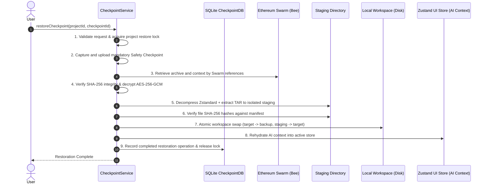

# AUTONEX CHECKPOINT ENGINE — RESTORATION AND RECOVERY SPECIFICATION

## Overview
The AUTONEX Checkpoint Restoration and Recovery Engine provides cryptographic and transactional guarantees when restoring an earlier checkpoint state in an AUTONEX project. When a user requests restoration to a target checkpoint (e.g., `CP-002`), the engine ensures genuine binary archive retrieval from Ethereum Swarm, isolated staging extraction, atomic workspace replacement with rollback safety, and full AI context rehydration.

---

## 9-Step Production Restoration Workflow



### Step 1: Validate Request & Acquire Lock
- **Validation:** Verifies project ID, ensures target checkpoint exists, and verifies status is `COMPLETED`.
- **Concurrency Lock:** Acquires an in-process restore lock (`activeRestoreLocks.add(projectId)`). Simultaneous restore operations on the same project are immediately rejected with an error.

### Step 2: Create Mandatory Safety Checkpoint
- Before modifying or touching the active workspace, a full safety checkpoint is captured:
  - Complete workspace snapshot is packaged into TAR + Zstandard, encrypted, and uploaded to Swarm.
  - Current AI context snapshot is encrypted and uploaded to Swarm.
  - If safety checkpoint creation fails for any reason, restoration is immediately aborted. The active workspace remains completely untouched.

### Step 3: Retrieve Selected Checkpoint Objects
- The engine fetches:
  - Archive Swarm reference (`bzzReference`).
  - AI context Swarm reference (`contextReference`).
  - Cryptographic checksums and encryption metadata from the SQLite database.
- Raw encrypted binary payloads are downloaded from Swarm using the Bee provider.

### Step 4: Verify and Decrypt
- Downloads are verified bit-for-bit against expected SHA-256 ciphertext checksums.
- Archive bytes are decrypted using AES-256-GCM with the stored initialization vector (IV) and authentication tag.
- AI context bytes are decrypted and verified against the canonical unencrypted payload SHA-256 checksum.

### Step 5: Sandboxed Staging Extraction
- Extraction occurs in an isolated, sandboxed staging directory: `${targetWorkspaceDir}.staging_${restoreId}`.
- Path traversal protection rejects any archive entry attempting path escaping (`../` or leading root paths).
- Files and directory permissions (`0o644` / `0o755`) are safely applied.

### Step 6: File Verification Against Manifest
- Every extracted file is hashed using SHA-256 and compared to the manifest recorded at checkpoint creation time.
- Total extracted file count and byte sizes are validated against manifest totals.
- If any discrepancy or corruption is detected, the staging directory is wiped and restoration aborts before the active workspace is touched.

### Step 7: Atomic Workspace Replacement & Rollback Safety
- POSIX-compliant atomic swap:
  1. Active workspace directory is renamed to `${targetWorkspaceDir}.backup_${restoreId}`.
  2. Verified staging directory is renamed to `${targetWorkspaceDir}`.
  3. If step 2 fails, the backup directory is immediately renamed back to the active path, ensuring zero workspace loss.
  4. On successful replacement, the backup directory is purged.

### Step 8: AI Context Rehydration
- The decrypted AI context is applied directly to the active system state:
  - Goals, execution states, tasks, and task statuses are restored to the exact state corresponding to the restored checkpoint.
  - Newer tasks created after the restored checkpoint are evicted from active memory.
  - Active store (`useStore`) and downstream agents resume with the restored context.

### Step 9: Post-Restoration State & Audit Persistence
- A permanent record is inserted into SQLite table `checkpoint_restores`:
  - `restore_id`, `project_id`, `checkpoint_id`, `safety_checkpoint_id`, `status: 'COMPLETED'`, timestamps.
- Project-level lock is released.
- Note: Checkpoints created after the target checkpoint are **NEVER** deleted. History is non-destructive.

---

## Empirical Verification: 16-Step Production Restoration Scenario

The restoration engine was verified under automated Vitest integration testing (`frontend/src/tests/checkpoint-restore.test.ts`):

```bash
 ✓ src/tests/checkpoint-restore.test.ts (3)
   ✓ AUTONEX Checkpoint Engine: Restoration and Recovery Engine (Phase 6) (3)
     ✓ Executes the 16-Step Production Restoration & Recovery Scenario
     ✓ Corrupted Archive Detection: aborts restoration cleanly without corrupting original workspace
     ✓ Lock Conflict: rejects simultaneous restoration operations on the same project

 Test Files  1 passed (1)
      Tests  3 passed (3)
```

### Scenario Execution Audit Log

| Step | Action | Verification / Outcome |
| :--- | :--- | :--- |
| **Step 1** | Create Project & Workspace | Workspace initialized with 3 initial files (`README.md`, `src/app.py`, `package.json`). |
| **Step 2** | Create Checkpoint `CP-001` | Swarm upload verified: 3 files captured. Checkpoint status `COMPLETED`. |
| **Step 3** | Add 5 new files | Workspace now contains 8 files (`services/auth.ts`, `services/db.ts`, etc.). AI context updated with 5 tasks. |
| **Step 4** | Create Checkpoint `CP-002` | Swarm upload verified: 8 files captured. Unique SHA-256 hashes recorded. |
| **Step 5** | Add 2 new files (total 10) | Workspace now contains 10 files. AI context has 7 tasks. |
| **Step 6** | Create Checkpoint `CP-003` | Swarm upload verified: 10 files captured. |
| **Step 7** | Modify files in workspace | Overwrote `src/app.py` with corrupted code and added temporary uncommitted file. |
| **Step 8** | Restart Checkpoint Engine | Service and SQLite database re-instantiated from disk. Stored checkpoints persisted. |
| **Step 9** | Restore Checkpoint `CP-002` | Restore lock acquired $\to$ Safety Checkpoint created $\to$ Staging extraction $\to$ Workspace replaced. |
| **Step 10** | Verify Workspace File Count | Exactly 8 files present on disk. The 2 files from CP-003 and uncommitted files were removed. |
| **Step 11** | Verify File Hashes | All 8 files match their SHA-256 hashes from CP-002 bit-for-bit. Restored `src/app.py` identical. |
| **Step 12** | Verify AI Context | Active store rehydrated: Exactly 5 tasks present with exact original statuses. Tasks from CP-003 removed. |
| **Step 13** | Verify Editable Source Code | Successfully edited `src/app.py` in restored workspace, confirming real disk files (not a virtual viewer). |
| **Step 14** | Verify Non-Destructive History | `CP-003` remains intact in checkpoint registry and can still be retrieved or restored. |
| **Step 15** | Rollback via Safety Checkpoint | Restored the safety checkpoint created in Step 9. |
| **Step 16** | Verify Rollback Integrity | Workspace restored to the 10 files and modified code from Step 7 before CP-002 restoration. |

