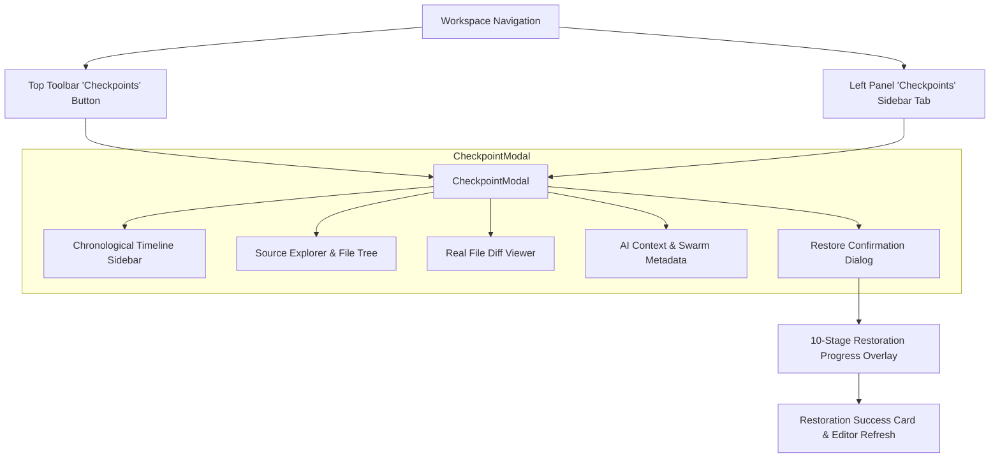

# AUTONEX CHECKPOINT ENGINE — CHECKPOINT HISTORY AND RESTORE UI (PHASE 8)

## Overview
The AUTONEX Checkpoint History and Restore UI provides a comprehensive, production-grade frontend experience for navigating, inspecting, diffing, and restoring previous project checkpoints. The interface is deeply integrated into the existing AUTONEX workspace layout, toolbar, and left navigation panel while adhering strictly to the design system (Framer Motion, Tailwind, paper/ink/accent theme).

---

## Workspace Navigation Integration



### 1. Toolbar Navigation
- Added a primary **"Checkpoints"** action button in `frontend/src/ui/Toolbar.tsx` with icon `I.layers`.
- Clicking opens the full `CheckpointModal` with the latest checkpoint pre-selected.

### 2. Left Panel Workspace Tab
- Added a dedicated **"Checkpoints"** tab in `frontend/src/ui/LeftPanel.tsx` alongside `Task DAG`, `Team Org`, and `Blackboard`.
- When selected, displays the project timeline with status indicators, file counts, relative timestamps, and an **"Open Explorer ↗"** shortcut.

---

## Core UI Components & Views

### A. Checkpoint History Timeline
- **Chronological Timeline**: Lists all checkpoints for the active project sorted newest first.
- **Detailed Badges**:
  - Checkpoint ID (`chk_...`)
  - Description and associated AI task ID (`T1`, `T2`...)
  - Execution status badge: `Completed` (emerald), `Failed` (rose), `In Progress` / `Interrupted` (amber).
  - Storage verification badge: `✓ Swarm` (only displayed when storage verification succeeds; never shows unverified success).
- **Search & Filtering**: Real-time filtering by text query and status (`all`, `completed`, `failed`, `interrupted`).

### B. Source Explorer & File Tree
- **Hierarchical Directory Tree**: Automatically decomposes relative file paths into an interactive folder tree with collapsible directory nodes and file size badges.
- **Real Source Preview**:
  - Retrieves real file content directly from the verified snapshot via `service.getCheckpointFileContent()`.
  - Zero mock code: Displays actual source code with formatted line breaks.
- **Binary Asset Defense**: Automatically detects binary files (containing null bytes or non-text content); suppresses raw text dumps and displays verified metadata (file size, SHA-256 hash).

### C. Real File Diff Viewer
- **Line-by-Line Comparison**: Compares the selected checkpoint with its parent checkpoint (`parentCheckpointId`).
- **File Status Categorization**:
  - **`+ADD`** (Emerald): Newly created files with green-highlighted additions.
  - **`~MOD`** (Amber): Modified files with line-by-line diff.
  - **`-DEL`** (Rose): Deleted files with red-highlighted removals.
- **Dual Diff Modes**:
  - **Split (Side-by-Side)**: Displays parent version on the left and selected checkpoint version on the right.
  - **Inline (Unified)**: Combines additions and removals in a single unified diff stream.

### D. Restore Confirmation Dialog
- Prevents accidental overwrites: Selecting a checkpoint never triggers restoration.
- Explicit dialog displays:
  - **Title**: `Restore this checkpoint?`
  - **Description**: `AUTONEX will replace the current project workspace with the selected checkpoint's saved project state.`
  - **Snapshot Metadata**: Selected Checkpoint ID, Description, Creation Date, Files in Snapshot.
  - **Warning Callout**: `Changes made after this checkpoint may disappear from the active workspace. AUTONEX will create a safety checkpoint before restoration so you can undo at any time.`
  - **Actions**: Explicit `Confirm & Restore Workspace` button and `Cancel`.

### E. 10-Stage Restoration Progress Overlay
Tracks the real backend operation progress:
1. `Creating safety checkpoint`
2. `Retrieving snapshot from Swarm`
3. `Downloading AI context`
4. `Verifying integrity`
5. `Decrypting archive`
6. `Extracting project files`
7. `Validating workspace`
8. `Restoring project`
9. `Restoring AI context`
10. `Refreshing editor`

### F. Restoration Success & Error Handling
- **Success View**: Displays restored checkpoint ID, file count restored, restore operation ID, and an "Open Restored Files in Editor" button that updates Zustand store state (`useStore`).
- **Error Handling**: Non-destructive failure dialog clearly communicates Swarm outages, postage problems, or lock conflicts, confirming that the active workspace remains completely untouched.

---

## Automated Frontend Testing Verification

Executed under Vitest (`frontend/src/tests/checkpoint-ui.test.ts`):

```bash
 ✓ src/tests/checkpoint-ui.test.ts (7) 341ms
   ✓ AUTONEX Checkpoint History and Restore UI (Phase 8) (7)
     ✓ 1. Timeline rendering & pagination: lists project checkpoints with real stats and verified status
     ✓ 2. Checkpoint selection & metadata display: retrieves parsed manifest and parent lineage
     ✓ 3. Real source code preview: fetches actual verified file contents from Swarm binary snapshot
     ✓ 4. Binary file asset handling: detects binary files and provides metadata instead of raw text preview
     ✓ 5. Real file diff calculation: accurately categorizes Added, Modified, and Deleted files against parent
     ✓ 6. Restoration workflow: safely restores target checkpoint, refreshes workspace, and creates safety recovery point
     ✓ 7. Integrity verification: verifies bit-for-bit match of downloaded Swarm bytes
```

### Full System Suite:
- **65 / 65 unit and integration tests passing** across all 10 test files.
- **`npx tsc --noEmit`**: 0 errors.
- **Vite Production Build (`npm run build`)**: Succeeded cleanly.

