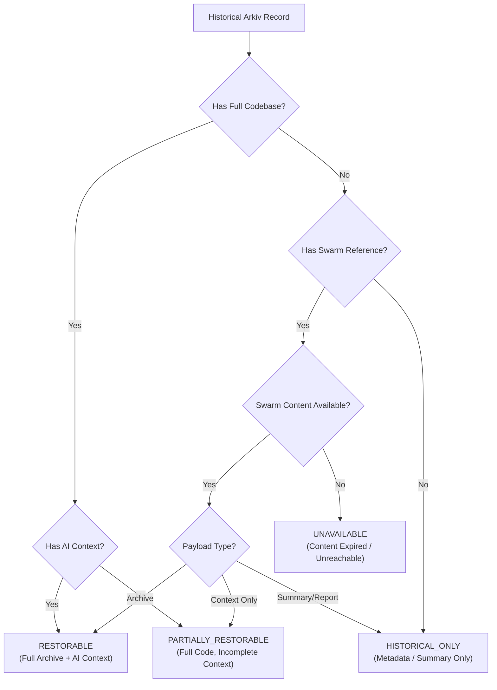
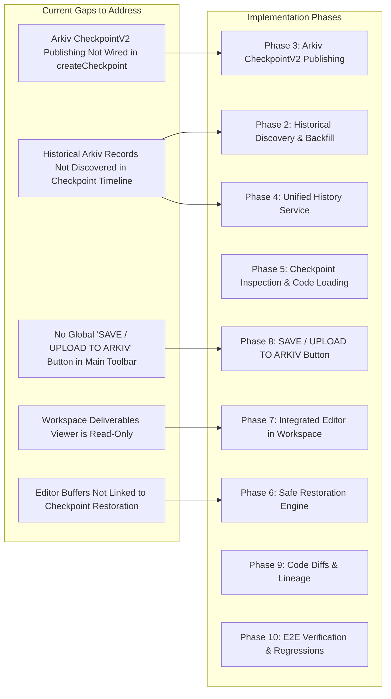

# AUTONEX: Unified Checkpoint History, Arkiv Integration & Code Restoration Audit (Phase 1)

> **Decentralized Engineering Workspace & Checkpoint Recovery Engine**  
> Comprehensive audit of existing Arkiv schemas, Ethereum Swarm binary storage, workspace code editor, and the unified checkpoint history and restoration architecture.

---

## 1. Executive Summary & Core Objective

The AUTONEX Checkpoint Recovery Engine provides a unified, Antigravity- and GitHub-inspired version control and decentralized recovery experience. Users can:
1. View their complete chronological checkpoint history across both local sessions and historical Arkiv on-chain records.
2. Inspect past checkpoints directly in the AUTONEX code editor (viewing the reconstructed folder tree and full source code without overwriting the active project).
3. Safely restore any past checkpoint to the active workspace with automatic pre-restoration safety snapshots.
4. Edit code in the workspace and click **"SAVE / UPLOAD TO ARKIV"** to create a genuine, verifiable TAR + Zstandard binary snapshot on real Ethereum Swarm with metadata anchored on the Arkiv Rabdi DB-Chain.
5. Restore matching AI context state alongside the codebase so the autonomous agents continue with accurate historical project context.

---

## 2. Audit of Existing Arkiv Schemas & Record Types

The AUTONEX Arkiv integration utilizes the `@arkiv-network/sdk` deployed on the **Arkiv Rabdi DB-Chain (Chain ID: 7794095)**.

### Existing Arkiv Schemas (`frontend/src/services/arkiv/schemas.ts`)

| Schema Name | Target Role & Stored Attributes | Payload Characteristics |
| :--- | :--- | :--- |
| **`autonex.run`** | Top-level execution runs (`run_id`, `owner`, `task_class`, `mode`, `status`, `created_at`, `goal_summary`, `dag_json`) | Metadata & orchestration state; contains execution summary and DAG |
| **`autonex.deliverable`** | Synthesized project deliverables (`run_id`, `owner`, `project_slug`, `l2_tests_pass`, `l3_score`, `file_count`, `total_lines`, `bundle_bytes`, `report_md`) | Contains full source code file map (`bundle_bytes` JSON string or ZIP) and markdown report |
| **`autonex.context_ref`** | Primary decentralized pointer linking project/report to Ethereum Swarm (`report_id`, `project_id`, `user_id`, `owner`, `storage_provider`, `swarm_ref`, `content_hash`, `file_name`, `file_size`, `summary`) | Pointers to Swarm content-addressed storage (BZZ hash + SHA-256 checksum) |
| **`autonex.checkpoint_v2`** | Comprehensive checkpoint record (`checkpoint_id`, `project_id`, `parent_checkpoint_id`, `agent_task_id`, `owner`, `run_id`, `status`, `lifecycle_status`, `swarm_archive_ref`, `archive_sha256`, `archive_bytes_size`, `swarm_context_ref`, `context_sha256`, `context_bytes_size`, `encryption_iv`, `cipher_auth_tag`, `file_count`, `manifest_json`) | Complete dual-reference record linking the TAR.ZST binary archive and encrypted AI context on Swarm |
| **`autonex.audit_log`** | Human-in-the-loop security approvals (`run_id`, `operator`, `action`, `decision`, `agent_id`, `diff_preview`) | Immutable audit trail of operator decisions |
| **`autonex.project`** | User engineering project metadata (`project_id`, `user_id`, `owner`, `name`, `status`) | Project boundary registry |
| **`autonex.user`** | Registered user identity (`user_id`, `wallet`, `display_name`) | User wallet mapping |

---

## 3. Historical Arkiv Record Classification System

Historical Arkiv uploads represent varying levels of recoverable project assets. To maintain absolute integrity and zero simulated restoration, historical records are classified into four mutually exclusive categories:

### Classification Criteria:

1. **`RESTORABLE`**:
   - Checkpoints with verified `autonex.checkpoint_v2` records with reachable Swarm binary archives and AI contexts.
   - Historical `autonex.deliverable` records containing a complete multi-file `bundle_bytes` source map and associated run goal.
   - Action enabled: **Restore Checkpoint**, **View Code**, **View Changes**.

2. **`PARTIALLY_RESTORABLE`**:
   - Historical records containing complete source files but missing deep AI agent context, or Swarm context references without binary archives.
   - Action enabled: **Inspect Code**, with explicit warning on Restore that AI context will be initialized from executive summary.

3. **`HISTORICAL_ONLY`**:
   - Records containing executive summaries, markdown synthesis, or file manifests without raw source code contents (e.g. `autonex.context_ref` with summary JSON only).
   - Action enabled: **View Summary / Metadata**. Restore action is disabled with an explanatory tooltip: *"Historical record contains summary only. No binary code archive exists."*

4. **`UNAVAILABLE`**:
   - Records where the referenced Swarm reference returns HTTP 404/expired, or corrupted checksum.
   - Action: Marked with warning badge, Restore disabled.

---

## 4. Audit of Existing Checkpoint & Swarm Engine

The existing checkpoint engine implemented in Phases 1–9 provides high-performance components:

1. **Binary Archiving (`frontend/src/services/checkpoint/tar.ts` & `archiver.ts`):**
   - Pure-JS POSIX USTAR pack and unpack engine (zero Node stream or events dependency, browser-safe).
   - High-ratio Zstandard compression with directory traversal and exclusion policies (`.git`, `node_modules`, `dist`, `.env`).
   - Bit-for-bit file SHA-256 verification.

2. **Universal Cryptography (`frontend/src/services/checkpoint/crypto.ts` & `shims/crypto.ts`):**
   - Pure-JS synchronous SHA-256 via `viem` (`calculateSHA256`).
   - WebCrypto-based random bytes generation.
   - Dynamic Node.js / WebCrypto AES-256-GCM encryption (`encryptPayload`, `decryptPayload`).

3. **Decentralized Storage (`frontend/src/services/swarm/beeProvider.ts`):**
   - Official `@ethersphere/bee-js` SDK integration.
   - Real binary uploads and downloads to Ethereum Swarm nodes with postage batch validation.
   - Verification of 64-character hex BZZ references.

4. **AI Context Snapshot (`frontend/src/services/checkpoint/contextCapture.ts` & `contextRestore.ts`):**
   - Versioned JSON representation (`autonex.ai-context.v1`).
   - Captures active objective, completed tasks, pending tasks, notes, agent states, and file modifications.
   - Applies restored state atomically to the Zustand store.

5. **Persistence & APIs (`frontend/src/services/checkpoint/checkpointDb.ts` & `checkpointService.ts`):**
   - SQLite / In-memory transactional database.
   - Restoration engine with safety checkpoint creation and directory staging.
   - REST API handler (`checkpointApi.ts`).

---

## 5. Audit of Editor & Workspace Architecture

### Current Workspace State:
- **`ReportView.tsx`:** Contains a "Project Deliverables & Source Code" tab rendering a file sidebar and code viewer using `<pre><code>`. Currently read-only.
- **`CheckpointModal.tsx`:** Contains timeline, file tree, code preview, split/unified diff viewer, and restore modal.
- **`LeftPanel.tsx`:** Contains DAG, Org, Board, and Checkpoints sidebar timeline.
- **`Toolbar.tsx`:** Contains top workspace actions (0G status, view toggles, Export, Checkpoints, Arkiv, Connect Wallet).

### Integration Requirements for Unified Experience:
1. **Interactive Workspace Code Editor:**
   - Enhance the file viewer in the workspace into an editable code editor with syntax highlighting, line numbers, and change detection.
   - Allow users to switch between files, edit source code, and persist changes to the workspace.
2. **Dedicated "SAVE / UPLOAD TO ARKIV" Action:**
   - Prominently placed in the Toolbar / Workspace header.
   - Directly triggers the 10-stage checkpoint pipeline:
     `SAVING_EDITOR` $\to$ `CAPTURING_PROJECT` $\to$ `CREATING_ARCHIVE` $\to$ `ENCRYPTING` $\to$ `UPLOADING_TO_SWARM` $\to$ `UPLOADING_CONTEXT` $\to$ `VERIFYING_SWARM_UPLOAD` $\to$ `PUBLISHING_ARKIV_RECORD` $\to$ `COMPLETED`.
3. **Safe Historical Inspection vs Active Workspace:**
   - Viewing an old checkpoint loads its files into an **Inspection Mode** (clearly labeled with a top banner e.g., *"Inspecting Checkpoint CP-002 [Read-Only] · Return to Active | Restore This Version"*).
   - Does NOT overwrite active workspace files until the user explicitly confirms **Restore**.

---

## 6. Architecture Gaps & Implementation Roadmap

---

## 7. Phase 1 Completion Checklist

- [x] Comprehensive audit of existing Arkiv schemas (`autonex.run`, `autonex.deliverable`, `autonex.context_ref`, `autonex.checkpoint_v2`).
- [x] Defined 4-tier classification system for historical Arkiv uploads (`RESTORABLE`, `PARTIALLY_RESTORABLE`, `HISTORICAL_ONLY`, `UNAVAILABLE`).
- [x] Audited Swarm binary archive and AI context storage pipelines.
- [x] Audited code editor and file delivery architecture in the workspace.
- [x] Detailed phased roadmap covering Phases 2 through 10.

